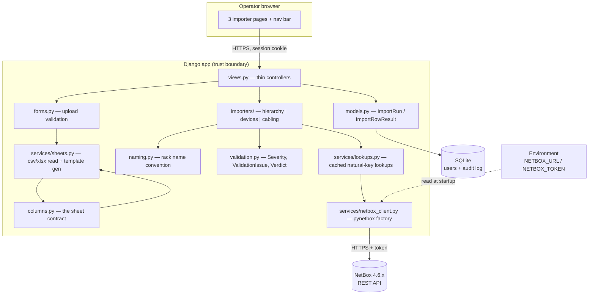
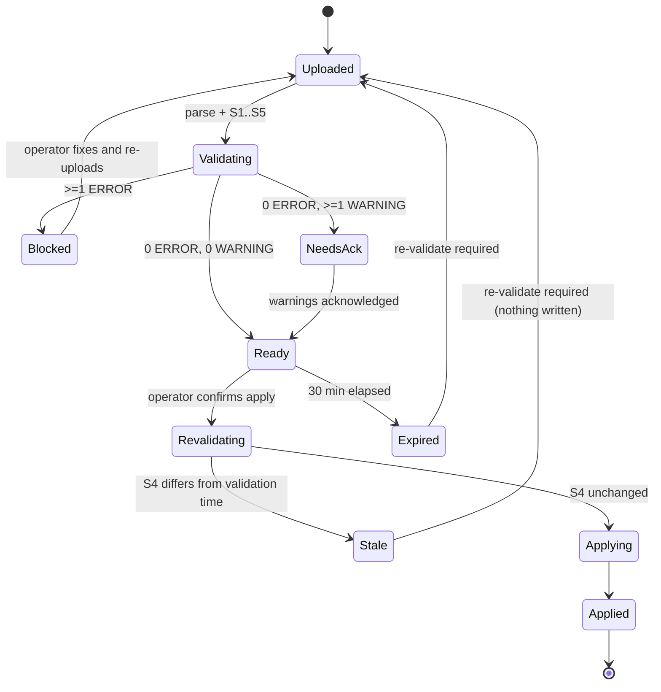
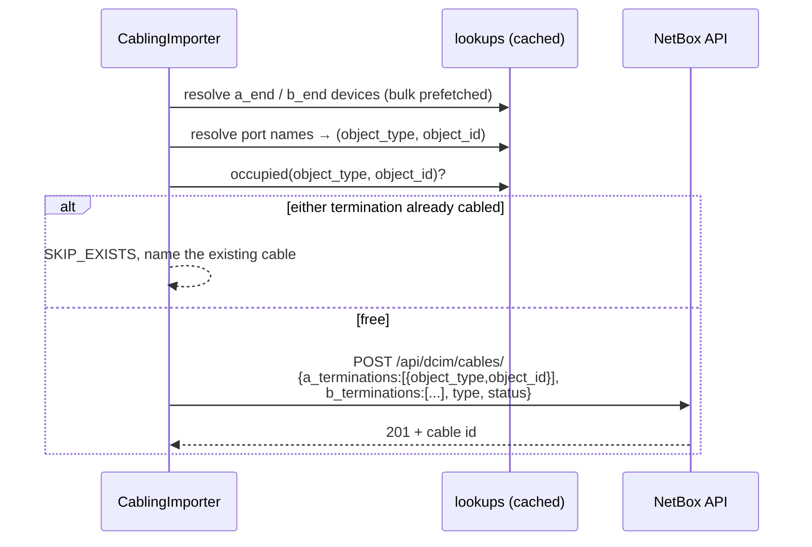

# Design — NetBox bulk provisioning (iteration 1: create only)

## Overview

A single-app Django site, server-rendered, with three importer pages. Each page follows the same
pipeline, gated so that **no write happens until the whole file validates clean**:

```
upload → parse → validate (S1..S5) → verdict
                                       ├── any ERROR ──→ blocked: report issues, apply disabled
                                       └── zero ERROR ─→ plan preview, apply enabled
                                                            ↓ operator confirms
                                                       re-run S4 (has NetBox moved?)
                                                            ├── changed → abort, nothing written
                                                            └── unchanged → apply → report
└──────────────── no writes to NetBox ────────────────┘                      └── writes ──┘
```

The gate is all-or-nothing per file: one bad row blocks the file. Partial application is not offered
even on request (Req 10.7), because a half-applied sheet is the exact failure this design exists to
prevent.

The app holds no copy of NetBox's inventory. Its only persistent data is the local user table and
an audit log of what each run submitted. NetBox stays the system of record.

Design status: **draft, pending review.** Open decisions D1–D5 in `requirements.md` are resolved
below with recommended defaults; changing one changes only the module named in its row.

## Architecture



### Why this shape

- **Importers are plain Python, not views.** `validate` / `plan` / `apply` take rows and a client
 and return results, so every rule in `requirements.md` is unit-testable against a stubbed HTTP
 layer with no browser and no live NetBox.
- **One column definition.** `columns.py` drives template generation *and* parsing *and*
 validation. A downloaded template cannot drift from what the parser accepts (Req 4.2).
- **The plan is the unit of consent.** Preview renders a plan; confirm applies *that stored plan*,
 not a re-read of the file, which closes the swap-the-file-between-steps gap (Req 10.12).
- **Validation is a gate, not advice.** The apply endpoint's first act is to ask the stored verdict
 whether it is applyable. A blocked plan cannot be applied by crafting a POST, so the guarantee
 lives in the server, not in a disabled button (Req 10.6).

## The validation gate

### Stages

Ordered, and each stage only runs if the previous one left the file interpretable (Req 10.4).

| Stage | Checks | Needs NetBox? |
| --- | --- | --- |
| **S1** file structure | extension, size, worksheet present, required columns, unknown columns, example row still present | no |
| **S2** cell format | required-but-blank, integer/enum coercion, rack-name shape, choice values against cached API choices | choices only |
| **S3** intra-file consistency | duplicate racks, duplicate device names, RU-range overlap between rows, the same cable termination used twice, rack name disagreeing with its own datacenter/datahall columns | no |
| **S4** cross-reference | referenced racks/models/roles/tenants exist, ports resolve, terminations not already cabled, slugs and unique fields free, existing objects match the sheet | yes |
| **S5** feasibility | parent-before-child ordering resolvable, row count within the bound, no contradictory creates | no |

S4 is the only stage whose result can go stale, which is why it alone is re-run at apply time.

### Verdict state machine



Only the `Ready → Revalidating → Applying` path writes. Every other transition is read-only.

### Issue model

```python
class Severity(StrEnum):
    ERROR = "error"      # blocks the entire file
    WARNING = "warning"  # must be acknowledged, does not block
    INFO = "info"        # already-exists skips, ignored columns

@dataclass(frozen=True)
class ValidationIssue:
    severity: Severity
    code: str                      # stable, e.g. "RU_RANGE_OVERLAP"
    file: str                      # uploaded filename
    sheet: str                     # worksheet name; the filename for csv
    line: int | None               # spreadsheet line as seen in Excel, header = 1
    column: str | None             # header text, not the internal key
    value: str = ""                # what was received
    expected: str = ""             # what was required
    message: str = ""              # operator-facing sentence
    related_line: int | None = None       # the other row, for duplicates
    related_object: str | None = None     # "dcim.rack SYD1-DH1-R01"
    related_url: str | None = None        # deep link into NetBox

    def location(self) -> str:
        return f"file {self.file}, sheet {self.sheet}, line {self.line}, column {self.column}"
```

**Line numbering.** Parsed rows carry the spreadsheet line they came from, not their index in the
data. With a header on line 1 and a guidance row on line 2, the first data row is line 3 — and that
is the number reported, so "line 47" is the line the operator sees in Excel (Req 16.2).

Rendered form, matching the requested shape:

```
ERROR  RU_RANGE_OVERLAP
  file devices-syd1.xlsx, sheet Devices, line 47, column bottom_ru
  received "12", expected a range not overlapping rack SYD1-DH1-R01 front face
  syd1-dh1-r01-leaf01 would occupy U12-U13, already taken by line 31 (syd1-dh1-r01-leaf02)
```

### Plan and verdict types

```python
@dataclass
class Verdict:
    issues: list[ValidationIssue]
    stages_completed: list[str]          # e.g. ["S1","S2","S3"] when S4/S5 were not reached
    file_fingerprint: str                # sha256 of the upload; binds plan to file (Req 10.13)
    validated_at: datetime
    acknowledged_warnings: bool = False

    @property
    def errors(self) -> list[ValidationIssue]: ...
    @property
    def is_applyable(self) -> bool:
        """Zero errors, all stages reached, warnings acknowledged, not expired."""
```

`views.apply` calls `verdict.is_applyable` before anything else and returns 409 with the reason when
it is false. The template's disabled button is a courtesy; this check is the actual gate.

### Guarding the window between validation and apply

Validation proves the file was consistent with NetBox *at validation time*. Three things can still
intervene, and each has a specific mitigation:

| Risk | Mitigation | Requirement |
| --- | --- | --- |
| Someone else changes NetBox after validation | Re-run S4 immediately before the first write; abort with nothing written if anything moved | 10.14 |
| The operator edits and re-uploads the file | Plan bound to a sha256 fingerprint; a different file discards the verdict | 10.13 |
| A verdict sits in a stale browser tab for hours | Verdicts expire after 30 minutes | 10.15 |
| NetBox rejects a row mid-apply anyway | Bulk POST per endpoint to shrink the window, plus ordered audit records for unwind | 12.4, D7 |

**Residual risk, stated plainly.** This gate makes a half-complete import unlikely, not impossible.
NetBox's REST API offers no dry-run and no cross-request transaction, so a server-side validator, a
custom validation plugin, or a concurrent change can still reject a write that passed our checks. The
honest guarantee is: *we will not start writing a file we know to be broken, and we will stop at the
first sign the world moved* — not *writes cannot fail midway*. The audit log exists for that
remainder.

Note also that TurboBulk, a NetBox Labs plugin, does offer true dry-run validation with rollback.
If it is ever available on the target instance it would strengthen this design considerably; it is
not assumed here.

## Data classification and flow

| Store / flow | Classification | Handling |
| --- | --- | --- |
| `NETBOX_TOKEN` | CONFIDENTIAL | Environment only. Never rendered, logged, persisted, or included in an error. |
| `DJANGO_SECRET_KEY` | CONFIDENTIAL | Environment only. |
| Uploaded spreadsheet | INTERNAL | Parsed in memory / temp file, deleted in `finally`. Never written to a served path. |
| Plan held between preview and confirm | INTERNAL | Server-side session or short-lived DB row, scoped to the user, cleared on logout. |
| `ImportRun` / `ImportRowResult` | INTERNAL | Object ids, names, outcomes. No credentials, no file contents. |
| Local user table | CONFIDENTIAL (password hashes) | Django's default hasher. |
| App → NetBox | INTERNAL over TLS | HTTPS with certificate verification on. |

### Trust boundaries

1. **Browser → Django.** Untrusted request data even though the user is a trusted engineer:
 session auth, superuser check, CSRF on every mutation, upload type and size limits.
2. **Spreadsheet → Django.** The file is untrusted input regardless of who uploaded it. Formulas
 are not evaluated, cells are coerced explicitly, nothing is rendered as raw HTML.
3. **Django → NetBox.** The token crosses this boundary and must not cross any other.
4. **NetBox response → Django.** API responses are data, never instructions; error strings are
 escaped before display.

## Threat model

OWASP Top 10 baseline, scoped to what this app actually does.

| # | Threat | Vector | Mitigation | Requirement |
| --- | --- | --- | --- | --- |
| T1 | Token disclosure | Token echoed in a debug page, log line, or audit record | Env-only; `DEBUG=false`; explicit redaction in the error formatter; audit schema has no token field | 2.4, 12.7, 14.1 |
| T2 | Broken access control | Unauthenticated or non-superuser reaching an importer | `login_required` + superuser test on every view; default-deny mixin on the base view class | 1.2, 1.3 |
| T3 | Unauthorised bulk write (CSRF) | Forged POST applying a plan | CSRF token required; apply is POST-only; plan bound to the session that created it | 10.6, 10.8, 14.3 |
| T4 | Malicious upload | Zip-bomb / huge xlsx, formula injection, spoofed extension | Size cap before parse; extension + content-type allow-list; `openpyxl` read-only, values not formulas | 5.1, 5.2, 5.3 |
| T5 | Stored XSS via cell content | A cell containing markup rendered into the preview table | Django autoescaping; no `mark_safe` on sheet or NetBox values | 5.7, 14.4 |
| T6 | Destructive mistake at scale | A wrong sheet mass-creating objects | Create-only (never update/delete); mandatory preview; explicit confirm; idempotent skip | 10.1, 10.4, 11.3 |
| T7 | MITM on the NetBox path | Downgraded or unverified TLS | HTTPS only, verification on by default; override warns loudly in logs and UI | 2.3, 14.5 |
| T8 | CSV injection in exported reports | Report cell beginning `=`/`+`/`-`/`@` executing in Excel | Prefix formula-leading values with `'` when writing report CSVs | 12.6 |
| T9 | Repudiation | No record of who ran a bulk change | Durable `ImportRun` per apply, UI-immutable, with actor and counts | 13.1, 13.5 |
| T10 | Partial-write confusion | Aborted run leaves NetBox half-populated and operator misled | Ordered record of applied creates; UI states rollback is not possible | 12.4, 12.5 |

**Known residual risk.** NetBox offers no cross-request transaction, so a batch can be partially
applied. Iteration 1 accepts this and mitigates with ordered audit records for manual unwind
rather than attempting compensating deletes, which could destroy pre-existing objects.

**Approval.** This threat model needs Security sign-off before implementation proceeds. Note also
that the working copy's `.env` contains a live production token committed to no repo but present
on disk — it should be rotated if it has ever been shared, and `.gitignore` now excludes it.

## Resolved decisions

| ID | Decision | Rationale | Blast radius if changed |
| --- | --- | --- | --- |
| D1 | Location → `dcim.Region`, Datacenter → `dcim.Site`, Datahall → `dcim.Location` | Matches NetBox's own geographic hierarchy; a Location is site-scoped, which is exactly what a datahall is | `importers/hierarchy.py` + lookups |
| D2 | Optional `device_role` column, falling back to `NETBOX_DEFAULT_DEVICE_ROLE`; reject if neither resolves | NetBox requires a role; silently inventing one would produce misleading data | `importers/devices.py` |
| D3 | Transceiver recording deferred to iteration 2; no such column exists | Setting `interface.type` cannot record anything once device types define interface types, and every other mechanism is a bigger change than iteration 1 warrants | nothing — the feature is absent |
| D4 | Device-type autocreate off by default, opt-in via env | Accidentally creating device types from typos pollutes a shared NetBox | `importers/devices.py` |
| D5 | Apply runs inline in the request, bounded by a max row count | No worker infrastructure for iteration 1 | `views.py` |

## Component design

### `columns.py` — the sheet contract

```python
@dataclass(frozen=True)
class ColumnSpec:
    key: str                      # snake_case; also the exact header text
    label: str                    # human header shown in templates
    required: bool
    help_text: str                # rendered into the template guidance row
    choices: tuple[str, ...] = () # drives xlsx picklists and validation
    example: str = ""             # synthetic sample value

HIERARCHY_COLUMNS: tuple[ColumnSpec, ...]
DEVICE_COLUMNS: tuple[ColumnSpec, ...]
CABLING_COLUMNS: tuple[ColumnSpec, ...]
```

### `naming.py` — rack name convention

```python
@dataclass(frozen=True)
class RackName:
    datacenter: str
    datahall: str
    rack: str
    raw: str

def parse_rack_name(value: str, delimiter: str = "-") -> RackName:
    """Split into exactly 3 non-empty segments. Raises RowError otherwise."""

def build_rack_name(datacenter: str, datahall: str, rack: str, delimiter: str = "-") -> str: ...
```

The only module that knows the convention (Req 6.5).

### `importers/base.py` — the shared pipeline

```python
class RowOutcome(StrEnum):
    CREATE = "create"; SKIP_EXISTS = "skip_exists"; BLOCKED = "blocked"; PARTIAL = "partial"

@dataclass
class PlannedRow:
    line: int                        # spreadsheet line, matching what Excel shows
    outcome: RowOutcome
    actions: list[CreateAction]      # ordered NetBox creates for this row
    issues: list[ValidationIssue]    # attached to this line, any severity
    resolved: dict[str, str]         # e.g. {"site": "SYD1", "rack": "SYD1-DH1-R01"}

@dataclass
class CreateAction:
    endpoint: str                    # "dcim.racks"
    payload: dict[str, Any]
    natural_key: dict[str, Any]      # used for the pre-create existence check

@dataclass
class Plan:
    rows: list[PlannedRow]
    verdict: Verdict
    importer: str

class Importer(Protocol):
    columns: tuple[ColumnSpec, ...]
    def validate_local(self, rows: Sequence[Row]) -> list[ValidationIssue]: ...   # S1–S3
    def validate_remote(self, rows: Sequence[Row]) -> list[ValidationIssue]: ...  # S4
    def plan(self, rows: Sequence[Row]) -> Plan: ...                              # + S5
    def apply(self, plan: Plan) -> RunReport: ...
```

`validate_local` covers structure, format, and intra-file rules with no NetBox dependency, so most
of the test suite needs no HTTP stub at all. `validate_remote` is stage S4, split out precisely
because it is the one that must be re-run at apply time (Req 10.14). `plan` composes both plus S5
into a `Verdict`. `apply` refuses outright unless `plan.verdict.is_applyable`, re-runs S4, then walks
the actions in order.

### `services/lookups.py` — idempotency and choices

Per-request cache keyed by `(endpoint, natural_key)`. Prefetches the referenced sets in bulk —
sites, locations, racks, device types, roles, and for cabling the terminations of every device
named in the sheet — so validating 2,000 rows is a handful of requests, not thousands (Req 15.2).

```python
def get_or_none(endpoint: str, **natural_key) -> Record | None: ...
def prefetch(endpoint: str, **filters) -> None: ...
def choices_for(endpoint: str, field: str) -> frozenset[str]: ...   # from the API, cached
def terminations_for(device_id: int, kind: Literal["interface","frontport","rearport"]) -> dict[str, int]: ...
def occupied(object_type: str, object_id: int) -> Cable | None: ...
```

### `services/netbox_client.py`

Builds the `pynetbox` API object from environment config, applies `NETBOX_VERIFY_SSL` and
`NETBOX_TIMEOUT`, probes `/api/status/` once per process for the version, and classifies
connection failures into DNS / TLS / timeout / auth for Req 2.5. Every exception it raises is
redacted of headers before it can reach a template.

## Sheet definitions

### Sheet 1 — hierarchy (one row per rack)

| Column | Req | Format / choices | NetBox target |
| --- | --- | --- | --- |
| `location` | yes | text | `dcim.Region.name` (+ derived slug) |
| `datacenter` | yes | text | `dcim.Site.name` (+ derived slug), region = row's location |
| `datahall` | yes | text | `dcim.Location.name`, site-scoped |
| `rack` | yes | `<datacenter>-<datahall>-<rack>` | `dcim.Rack.name` |
| `rack_u_height` | yes | positive int | `Rack.u_height` |
| `rack_width` | no | 10 / 19 / 21 / 23, default 19 | `Rack.width` |
| `rack_status` | no | from API, default `active` | `Rack.status` |
| `rack_type` | no | from API | `Rack.type` |
| `tenant` | no | existing tenant name | `Rack.tenant` |
| `description` | no | text | `Rack.description` |

Example row: `APAC, SYD1, DH1, SYD1-DH1-R01, 45, 19, active, 4-post-frame, , spine row A`

### Sheet 2 — devices

| Column | Req | Format / choices | NetBox target |
| --- | --- | --- | --- |
| `rack` | yes | existing rack name | `Device.rack` (+ site derived from it) |
| `rack_face` | yes | front / rear | `Device.face` |
| `bottom_ru` | yes | positive int | `Device.position` |
| `ru_height` | yes | positive int | validated against `DeviceType.u_height` |
| `device_name` | yes | text | `Device.name` |
| `model` | yes | existing device type model | `Device.device_type` |
| `serial` | no | text | `Device.serial` |
| `manufacturer` | no | required only when autocreating a type | `DeviceType.manufacturer` |
| `device_role` | no | existing role, default from env | `Device.role` |
| `status` | no | from API, default `active` | `Device.status` |
| `asset_tag` | no | text, unique in NetBox | `Device.asset_tag` |
| `tenant` | no | existing tenant | `Device.tenant` |

Example row: `SYD1-DH1-R01, front, 12, 2, syd1-dh1-r01-leaf01, DCS-7050SX3-48YC8, , Arista, leaf-switch, active, ,`

### Sheet 3 — cabling

| Column | Req | Format / choices | Notes |
| --- | --- | --- | --- |
| `a_end` / `b_end` | yes | device or panel name | must already exist |
| `a_end_kind` / `b_end_kind` | yes | device / panel, default device | selects the termination model |
| `a_port` / `b_port` | yes | port name on that end | interface, or front/rear port for a panel |
| `a_port_side` / `b_port_side` | no | front / rear, default front | panels only; ignored for devices |
| `cable_type` | yes | from API (`cat6`, `cat6a`, `mmf-om4`, `smf-os2`, `dac-passive`, …) | |
| ~~`transceiver`~~ | — | — | dropped from iteration 1 (D3); treated as an unrecognised column if present |
| `cable_status` | no | default `connected` | |
| `label`, `color`, `length`, `length_unit` | no | `length_unit` from API | |

Example row: `syd1-dh1-r01-leaf01, device, Ethernet49/1, syd1-dh1-pp01, panel, Port 1, front, mmf-om4, QSFP-100G-SR4, connected, LNK-0001, , 3, m`

Termination mapping: `device` → `dcim.interface`; `panel` + `front` → `dcim.frontport`;
`panel` + `rear` → `dcim.rearport`.

## NetBox interaction

### Ordering

Hierarchy creates strictly parents-first: region → site → location → rack. Devices need racks, so
the device sheet only reads them. Cabling needs devices and their ports, so it only reads those.
Within a sheet, rows are applied in file order (Req 8.12) so the report lines up with the sheet.

### Cable creation



### Every write is a create

With transceiver recording deferred (D3), iteration 1 has **no** code path that modifies an object it
did not create. That is worth stating as an invariant rather than a coincidence: it makes the blast
radius of a mistaken import bounded by what it added, and it means a reviewer can verify the property
by grepping for `PATCH` and `DELETE` and finding none.

Why the interface-type route was abandoned: a device type defines interface templates, and devices
inherit their interfaces — already typed — from them. Requirement 11.3 forbids overwriting an
existing value, so the transceiver column could only ever confirm or contradict a type that was
already set, never record which optic is actually installed. Iteration 2 should use an inventory item
or a module, both of which can hold a part number.

Terminations are always sent as arrays on `/api/dcim/cables/`. The
`/api/dcim/cable-terminations/` endpoint is read-only in current NetBox and is never written to,
since bypassing the cables endpoint breaks path tracing.

## Data models (local, audit only)

```python
class ImportRun(models.Model):
    importer      = models.CharField(choices=["hierarchy", "devices", "cabling"])
    user          = models.ForeignKey(User, on_delete=models.PROTECT)
    filename      = models.CharField(max_length=255)
    netbox_host   = models.CharField(max_length=255)   # host only, no token
    netbox_version = models.CharField(max_length=32, blank=True)
    started_at    = models.DateTimeField(auto_now_add=True)
    finished_at   = models.DateTimeField(null=True, blank=True)
    created_count = models.PositiveIntegerField(default=0)
    skipped_count = models.PositiveIntegerField(default=0)
    error_count   = models.PositiveIntegerField(default=0)
    warning_count = models.PositiveIntegerField(default=0)
    # A blocked attempt is still a run: it is auditable even though nothing was written.
    verdict       = models.CharField(max_length=16)    # blocked | ready | applied | stale | expired
    file_fingerprint = models.CharField(max_length=64) # sha256 of the upload
    stages_completed = models.CharField(max_length=32) # e.g. "S1,S2,S3"
    warnings_acknowledged = models.BooleanField(default=False)
    validated_at  = models.DateTimeField(null=True, blank=True)
    applied_at    = models.DateTimeField(null=True, blank=True)
    aborted_reason = models.CharField(max_length=255, blank=True)

class ImportRowResult(models.Model):
    run          = models.ForeignKey(ImportRun, related_name="rows", on_delete=models.CASCADE)
    line         = models.PositiveIntegerField()       # spreadsheet line as shown in Excel
    outcome      = models.CharField(max_length=16)     # RowOutcome
    object_type  = models.CharField(max_length=64, blank=True)   # "dcim.rack"
    object_id    = models.PositiveIntegerField(null=True, blank=True)
    object_name  = models.CharField(max_length=255, blank=True)
    message      = models.TextField(blank=True)
    sequence     = models.PositiveIntegerField()       # apply order, for manual unwind

class ValidationIssueRecord(models.Model):
    """Persisted so a blocked attempt is auditable and re-openable (Req 16.11)."""
    run        = models.ForeignKey(ImportRun, related_name="issues", on_delete=models.CASCADE)
    severity   = models.CharField(max_length=8)
    code       = models.CharField(max_length=48, db_index=True)
    sheet      = models.CharField(max_length=255)
    line       = models.PositiveIntegerField(null=True, blank=True)
    column     = models.CharField(max_length=64, blank=True)
    value      = models.TextField(blank=True)
    expected   = models.TextField(blank=True)
    message    = models.TextField(blank=True)
```

Deliberately absent: the token, the uploaded file, and any raw cell dump. `value` holds only the
single offending cell, which is what makes the issue actionable.

## Pages and URLs

| URL | Name | Purpose |
| --- | --- | --- |
| `/login/`, `/logout/` | `login`, `logout` | Django auth views, local only |
| `/` | `importer:home` | Redirects to hierarchy; shows NetBox connection status |
| `/hierarchy/` | `importer:hierarchy` | Sheet 1 upload + verdict + preview |
| `/devices/` | `importer:devices` | Sheet 2 upload + verdict + preview |
| `/cabling/` | `importer:cabling` | Sheet 3 upload + verdict + preview |
| `/<page>/template.<csv\|xlsx>` | `importer:<page>_template` | Template download |
| `/<page>/validate/` | `importer:<page>_validate` | POST-only; upload + validate, never writes |
| `/<page>/acknowledge/` | `importer:<page>_ack` | POST-only; acknowledge warnings |
| `/<page>/apply/` | `importer:<page>_apply` | POST-only, CSRF-protected, refuses unless applyable |
| `/runs/`, `/runs/<id>/` | `importer:runs`, `importer:run_detail` | Audit history, read-only |
| `/runs/<id>/issues.csv` | `importer:run_issues` | Validation report CSV, formula-escaped |
| `/runs/<id>/report.csv` | `importer:run_report` | Apply result CSV, formula-escaped |

UI is one `base.html` with the nav bar, plus three shared partials: `_verdict_banner.html` (the
blocked/ready summary), `_issue_list.html` (issues grouped by severity then line), and
`_preview_table.html` (the per-row plan). Bootstrap 5 from a pinned local static file — no CDN, no
build step.

Each importer page is a single screen with three stacked regions, so the operator never loses
context: the upload form, then the verdict banner with the issue list, then the plan preview with the
apply button. A blocked file shows regions one and two, with the apply button absent rather than
merely greyed out.

## Error handling

| Class | Stage | Handling | Operator sees |
| --- | --- | --- | --- |
| Bad type, oversize, missing columns | S1 | ERROR; stop, later stages not reached | All problems at once, with accepted formats and columns |
| Bad format, bad choice value | S2 | ERROR; file blocked | file / sheet / line / column, received, expected |
| In-file duplicate, RU overlap, reused termination | S3 | ERROR; file blocked | Both line numbers involved |
| Reference not found | S4 | ERROR; file blocked | Which lookup failed and the value tried |
| Already exists, all values match | S4 | INFO; does not block | Which object matched, with a NetBox link |
| Already exists, values differ | S4 | ERROR by default (decision D8) | Field, sheet value, NetBox value |
| Unrecognised column, e.g. a leftover `transceiver` | S1 | INFO; does not block | The column name, and that it was ignored |
| Row count over the bound | S5 | ERROR; file blocked | The limit and the advice to split the file |
| NetBox moved since validation | pre-apply | Abort before the first write | What changed; re-validate required |
| Verdict expired or fingerprint changed | pre-apply | Refuse; re-validate | Why the verdict is stale |
| NetBox 400 despite validation | apply | Row `BLOCKED`; run continues per D7 strategy | NetBox's field errors mapped to line and column |
| NetBox 401/403 | apply | Abort run | Auth failure with host, never the token |
| Connection loss / timeout | apply | Abort run | Rows applied before the abort, in order |
| Unexpected exception | any | Abort, log traceback server-side | Generic message + run id; no traceback, no headers |

`RowError(code, column, value, expectation)` is the single exception type carrying a row-level
failure; it converts directly into a `ValidationIssue`, so location and message formatting live in
one place and cannot leak internals.

Note the asymmetry in the "NetBox 400 despite validation" row: it means our validator missed
something. Every occurrence is a bug in a validation stage, so its issue code is logged for follow-up
rather than treated as normal operation.

## Testing strategy

Live NetBox is never contacted in tests; HTTP is stubbed with `responses`.

- **Unit — `naming.py`:** valid 3-segment names, wrong segment counts, empty segments, alternate
 delimiter, case-insensitive comparison (Req 6).
- **Unit — `sheets.py`:** csv and xlsx parsing, reordered headers, case/whitespace in headers,
 missing required column, unknown column warning, blank rows, oversize rejection, formulas read
 as values, template round-trip (generate → parse yields the declared columns) (Req 4, 5).
- **Unit — importers, one test per numbered criterion:**
 - hierarchy: parent-before-child ordering, slug derivation and collision, duplicate rack rows,
 rack name vs column disagreement, same datahall name under two datacenters (Req 7)
 - devices: face validation, RU overflow past rack height, overlap with an existing device and
 with another row, `ru_height` vs device-type height mismatch, missing model with autocreate off
 then on, role fallback then failure, duplicate device name (Req 8)
 - cabling: device vs panel resolution, front vs rear side, ambiguous and missing ports,
 termination array payload shape, cable-type validation, already-occupied skip, same-port both
 ends, duplicate termination across rows (Req 9)
- **Create-only invariant:** across the whole suite, assert that no test ever causes a `PATCH`,
 `PUT`, or `DELETE` request to NetBox. This is the machine-checkable form of Requirement 11.3 and it
 is what makes the "we cannot damage what we did not create" claim verifiable rather than aspirational.
- **The gate — the highest-value tests in the suite (Req 10):**
 - a file with exactly one ERROR writes **nothing**: assert zero POST requests were issued
 - a forged POST to the apply endpoint on a blocked plan returns 409 and issues zero requests
 - partial application is not reachable by any request shape
 - zero errors plus unacknowledged warnings is not applyable; acknowledging makes it applyable
 - S1 failure reports which stages were not reached, and emits no S4 issues
 - all issues in a stage are reported in one pass, not just the first
 - a changed file fingerprint invalidates the verdict
 - a verdict older than the expiry window is refused
 - **stale detection:** stub NetBox to return a different state on the pre-apply S4 than during
 validation, then assert the run aborts with zero writes
- **Issue localisation (Req 16):** line numbers match the spreadsheet including the header and
 guidance rows, csv reports the filename as the sheet, duplicates name both lines, every issue
 carries a code, the CSV export escapes formula-leading values, display truncation kicks in at the
 cap while the CSV keeps everything.
- **Idempotency:** validate and apply the same file twice against a stubbed NetBox that starts
 empty; the second validation finds zero errors and the second apply creates nothing (Req 11.7).
- **View tests:** anonymous redirect, non-superuser 403, validate writes nothing, apply requires
 POST + CSRF, applying a plan twice is refused, logout clears the pending plan (Req 1, 10).
- **Security regression:** assert the token appears in no rendered page, log record, or
 `ImportRun` row, including on the error path (Req 14.1).
- **Fixtures:** synthetic only — `example.com`, fake serials, invented site codes. No production
 data, per policy.

## Deployment notes

Iteration 1 targets local/internal use: `runserver` for development, gunicorn behind an internal
reverse proxy otherwise. Requirements: Python 3.12–3.14, `DJANGO_DEBUG=false`, explicit
`ALLOWED_HOSTS` and `CSRF_TRUSTED_ORIGINS`, SQLite on a backed-up path, and a rotated NetBox token
scoped to the DCIM writes this tool needs. `python manage.py check --deploy` must be clean before
anyone else is pointed at it.
