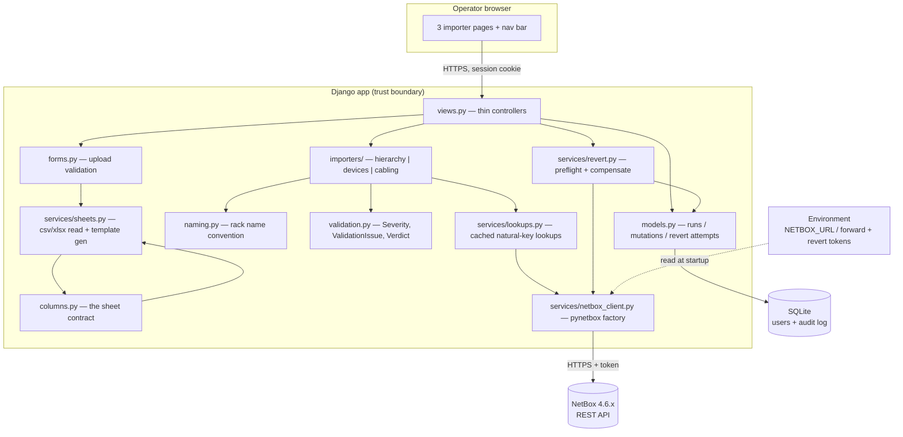
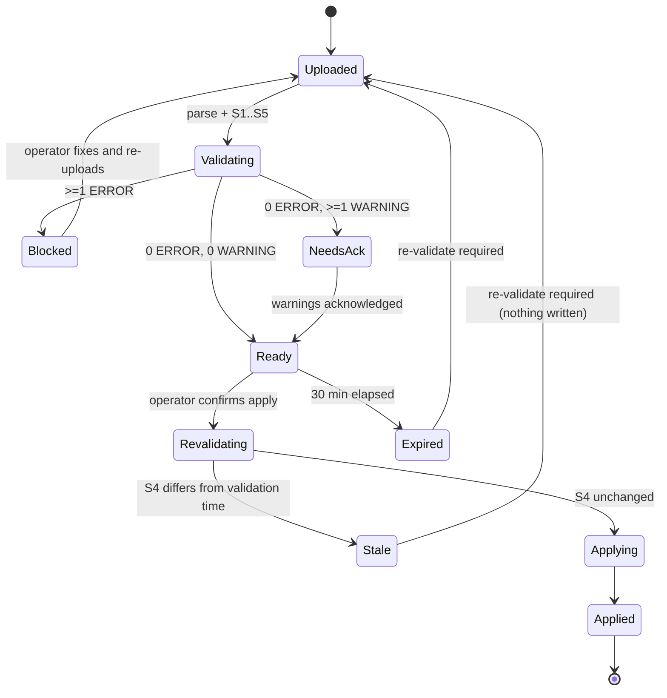
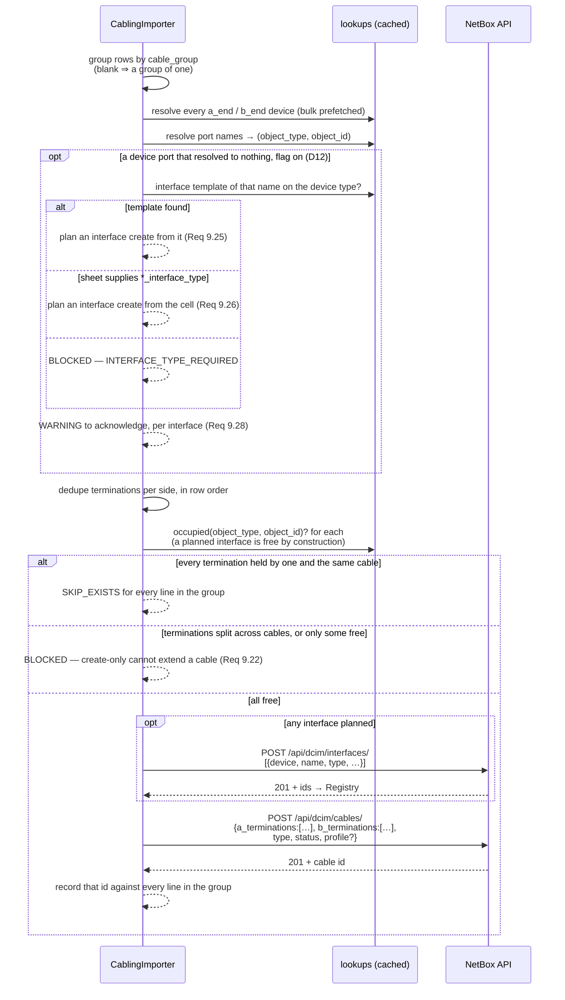

# Design — NetBox bulk provisioning (forward imports create only)

## Overview

A single-app Django site, server-rendered, with three importer pages. Each page follows the same
pipeline, gated so that **no write happens until the whole file validates clean**:

```
upload → parse → validate (S1..S5) → verdict
                                       ├── any ERROR ──→ blocked: report issues, apply disabled
                                       └── zero ERROR ─→ plan preview, apply enabled
                                                            ↓ operator confirms
                                                       re-run S4 (has NetBox moved?)
                                                            ├── changed → abort, nothing written
                                                            └── unchanged → apply → report
└──────────────── no writes to NetBox ────────────────┘                      └── writes ──┘
```

The gate is all-or-nothing per file: one bad row blocks the file. Partial application is not offered
even on request (Req 10.7), because a half-applied sheet is the exact failure this design exists to
prevent.

The app holds no general copy of NetBox's inventory. Its persistent data is the local user table,
the run audit log, and the minimal before/after values of fields the tool wrote. Those values form an
append-only mutation journal used for history summaries, drift checks, and compensating reverts;
NetBox remains the system of record.

Design status: **the original baseline is verified against NetBox 4.6.8 and complete.** Decisions
D1–D9 in `requirements.md` are settled and built; each one's blast radius if reversed is named in the
table below. **D10 — cable profiles and breakout — is built and verified**: its field-level facts were
probed read-only on 2026-08-20 and its behavioural ones by creating and deleting cables on
2026-08-24. Every assumption held, so nothing in Requirement 9 needed amending. The one thing still
taken on trust is the internal position map of a `-shuffle` profile, which NetBox does not serve. **D11 — loopback and management
addresses on the device sheet — is proposed and not yet built.** Its IPAM field names still need a
read-only probe against 4.6.8 before implementation. **D12 — creating a device interface the cabling
sheet names and NetBox does not have — is built and under test, but not probed**: it is the one
change that costs an existing property rather than only adding surface, because the cabling sheet
stops being a single bulk POST. The unprobed part is narrow and named — which template fields
`dcim.Interface` accepts verbatim, the list in `cabling.py`'s `TEMPLATE_CHOICE_FIELDS` /
`TEMPLATE_PLAIN_FIELDS` — and `scripts/probe_interface_creation.py` exists to settle it (task 31a).
**D13 — breakout child sub-interfaces and shuffle harnesses — is built and under test, with its live
probe outstanding.** It
extends D12 rather than adding a new mechanism: `a_parent` / `b_parent` turn `*_port` into a `virtual`
child created under a named cage, while the cable stays on the cage, and it decouples the parent from
`cable_group` so a shuffle (several cages per side under one harness) can be written at all. Three
facts need a live probe first — `virtual` + `parent` in a bulk POST, a `virtual` child refused as a
cable termination, and a cage's occupancy while children hang off it — carried as task 31b below.
**D14 — applied-change history and compensating revert — is decided and built, with Security Design
Authority review pending before merge or deployment.** It adds an
operation journal, history summaries, and a reverse-order revert flow that deletes only recorded
creates and restores only recorded changed fields after a strict drift check.
**D15 — profile-derived breakout tags — is built and tested, with its live probe outstanding.** It
adds an existing
`port-breakout-2x`, `port-breakout-4x`, or `port-breakout-8x` tag to each D13 physical parent,
derived from that profile side's positions per connector. Existing parents require a tags-only,
drift-checked PATCH and D14 UPDATE journal entry; a live 4.6.8 probe must confirm the writable tag
payload shape before implementation.
Field names in this document were checked against the target instance's own
`OPTIONS` responses rather than from memory — see "Verified against the target instance".

## Architecture



### Why this shape

- **Importers are plain Python, not views.** `validate` / `plan` / `apply` take rows and a client
 and return results, so every rule in `requirements.md` is unit-testable against a stubbed HTTP
 layer with no browser and no live NetBox.
- **One column definition.** `columns.py` drives template generation *and* parsing *and*
 validation. A downloaded template cannot drift from what the parser accepts (Req 4.2).
- **The plan is the unit of consent.** Preview renders a plan; confirm applies *that stored plan*,
 not a re-read of the file, which closes the swap-the-file-between-steps gap (Req 10.12).
- **Validation is a gate, not advice.** The apply endpoint's first act is to ask the stored verdict
 whether it is applyable. A blocked plan cannot be applied by crafting a POST, so the guarantee
 lives in the server, not in a disabled button (Req 10.6).

## The validation gate

### Stages

Ordered, and each stage only runs if the previous one left the file interpretable (Req 10.4).

| Stage | Checks | Needs NetBox? |
| --- | --- | --- |
| **S1** file structure | extension, size, worksheet present, required columns, unknown columns, example row still present | no |
| **S2** cell format | required-but-blank, integer/enum coercion, rack-name shape, choice values against cached API choices | choices only |
| **S3** intra-file consistency | duplicate racks, duplicate device names, duplicate loopback/management addresses, RU-range overlap between rows, the same cable termination used twice *outside* a shared `cable_group`, a group's rows disagreeing about the cable they describe, rack name disagreeing with its own datacenter/datahall columns | no |
| **S4** cross-reference | referenced racks/models/roles/tenants exist, ports resolve, terminations not already cabled, slugs and unique fields free, existing objects match the sheet, device-type `mgmt_only` / `loopback` interfaces resolve, IP addresses are free or already on the intended interface | yes |
| **S5** feasibility | parent-before-child ordering resolvable, row count within the bound, no contradictory creates | no |

S4 is the only stage whose result can go stale, which is why it alone is re-run at apply time.

### Verdict state machine



Only the `Ready → Revalidating → Applying` path writes. Every other transition is read-only.

### Issue model

```python
class Severity(StrEnum):
    ERROR = "error"      # blocks the entire file
    WARNING = "warning"  # must be acknowledged, does not block
    INFO = "info"        # already-exists skips, ignored columns

@dataclass(frozen=True)
class ValidationIssue:
    severity: Severity
    code: str                      # stable, e.g. "RU_RANGE_OVERLAP"
    file: str                      # uploaded filename
    sheet: str                     # worksheet name; the filename for csv
    line: int | None               # spreadsheet line as seen in Excel, header = 1
    column: str | None             # header text, not the internal key
    value: str = ""                # what was received
    expected: str = ""             # what was required
    message: str = ""              # operator-facing sentence
    related_line: int | None = None       # the other row, for duplicates
    related_object: str | None = None     # "dcim.rack SYD1-DH1-R01"
    related_url: str | None = None        # deep link into NetBox

    def location(self) -> str:
        return f"file {self.file}, sheet {self.sheet}, line {self.line}, column {self.column}"
```

**Line numbering.** Parsed rows carry the spreadsheet line they came from, not their index in the
data. With a header on line 1 and a guidance row on line 2, the first data row is line 3 — and that
is the number reported, so "line 47" is the line the operator sees in Excel (Req 16.2).

Rendered form, matching the requested shape:

```
ERROR  RU_RANGE_OVERLAP
  file devices-syd1.xlsx, sheet Devices, line 47, column bottom_ru
  received "12", expected a range not overlapping rack SYD1-DH1-R01 front face
  syd1-dh1-r01-leaf01 would occupy U12-U13, already taken by line 31 (syd1-dh1-r01-leaf02)
```

### Plan and verdict types

```python
@dataclass
class Verdict:
    issues: list[ValidationIssue]
    stages_completed: list[str]          # e.g. ["S1","S2","S3"] when S4/S5 were not reached
    file_fingerprint: str                # sha256 of the upload; binds plan to file (Req 10.13)
    validated_at: datetime
    acknowledged_warnings: bool = False

    @property
    def errors(self) -> list[ValidationIssue]: ...
    @property
    def is_applyable(self) -> bool:
        """Zero errors, all stages reached, warnings acknowledged, not expired."""
```

`views.apply` calls `verdict.is_applyable` before anything else and returns 409 with the reason when
it is false. The template's disabled button is a courtesy; this check is the actual gate.

### Guarding the window between validation and apply

Validation proves the file was consistent with NetBox *at validation time*. Three things can still
intervene, and each has a specific mitigation:

| Risk | Mitigation | Requirement |
| --- | --- | --- |
| Someone else changes NetBox after validation | Re-run S4 immediately before the first write; abort with nothing written if anything moved | 10.14 |
| The operator edits and re-uploads the file | Plan bound to a sha256 fingerprint; a different file discards the verdict | 10.13 |
| A verdict sits in a stale browser tab for hours | Verdicts expire after 30 minutes | 10.15 |
| NetBox rejects a row mid-apply anyway | One bulk POST per endpoint: the whole list rolls back, so no rows from that endpoint are written | 12.4, D7 |

### Measured: bulk create is atomic (D7)

Run against NetBox 4.6.8 on 2026-08-18. Three failure classes were tested because they fail at
different points in the request and could plausibly behave differently. All three rolled back
completely:

| Test | Failure class | Response | Survivors |
| --- | --- | --- | --- |
| A | Field-level: item 2 of 3 missing a required `name` | `400` with a per-item array `[{}, {"name": [...]}, {}]` | none |
| B | Deferred DB constraint: two items in one list sharing a slug | `500` `duplicate key value violates unique constraint` | none |
| C | NetBox model `clean()`: two devices claiming the same rack unit | `400 {"position": ["U10.0 is already occupied ..."]}` | none |
| Control | All-valid list of two devices | `201` | both created |

Test B is the one that settles it. A field-level error proves only that DRF validates the whole list
before writing anything; it says nothing about transactions. B failed *during* the write — the first
insert succeeded and the second violated a database constraint — and the first was still rolled back.
NetBox wraps the request in a transaction.

**Consequence for apply:** creates are grouped by endpoint and issued as one bulk POST each. The
half-complete window is no longer "between any two rows" but "between two endpoints" — for the
hierarchy importer that is three boundaries (regions → sites → locations → racks) regardless of
whether the sheet has 4 rows or 4,000. Devices and cabling are single-endpoint, so each of those
sheets applies as one all-or-nothing operation.

**The catch — error attribution.** The three tests returned errors in two different shapes. Test A
came back as an array positionally aligned to the submitted items, so an error maps cleanly to a
spreadsheet line. Test C came back as a single un-indexed object: NetBox reported *that* a position
was occupied, not *which* item caused it. Requirements 12.2 and 16.1 demand line-level attribution,
so `apply` needs a fallback: when a bulk POST fails with an un-indexed error, replay the same list
row by row to identify the offender. That replay is safe precisely because the bulk attempt wrote
nothing. It is also rare by construction — a mid-apply failure means stage S4 missed something, which
is a validator bug worth surfacing.

**Residual risk, restated.** The remaining exposure is narrow but real: a multi-endpoint importer can
still fail on its second or third endpoint after the first succeeded, leaving, say, sites created
without their racks. That is recoverable and non-destructive — re-running the sheet skips what
exists and creates the remainder — but it is not nothing. NetBox offers no cross-request transaction,
so this cannot be closed without branching (see below).

Note also that TurboBulk, a NetBox Labs plugin, offers true dry-run validation with rollback, and
netbox-branching would allow the entire import to be staged in a branch and merged atomically across
endpoints, closing the residual window above. Neither is assumed here; netbox-branching would need a
licence review first.

## Verified against the target instance

Field names, required fields, and choice values below were read from the target's own `OPTIONS`
responses on NetBox 4.6.8 (2026-08-18) before any importer was written, because a column aimed at a
renamed field fails at apply time — after the operator has been told the file is clean.

| Checked | Result |
| --- | --- |
| Rack enumerated form factor | `form_factor`, **not** `type`. `rack_type` is a foreign key to the `RackType` model, so a `4-post-cabinet` string sent there would be rejected as an invalid id |
| `Rack.width` choices | `10, 19, 21, 23` — matches the sheet definition |
| `Rack.status` choices | `reserved, available, planned, active, deprecated` |
| Required on create | region/site/location: `name` + `slug` (location also `site`); rack: `name` + `site`; device: `device_type` + `role` + `site`; cable: nothing |
| `dcim.Location` slug | **required**, same as regions and sites — the spec previously derived slugs for regions and sites only |
| Slug validation | `^[-a-zA-Z0-9_]+$`, max length 100, uppercase accepted. The hyphen being legal in a NetBox slug is what forces the tool's own stricter rule on the two slugs a rack name is built from (Req 6.6) |
| `Device.face` choices | `front, rear` |
| `Cable.type` choices | includes `cat6`, `cat6a`, `mmf-om4`, `smf-os2`, `dac-passive` as the sheet examples assume |
| `Cable.status` / `length_unit` | `connected, planned, decommissioning` / `km, m, cm, mi, ft, in` |
| Front-port mapping format | `rear_ports: [{position, rear_port, rear_port_position}]`, the 4.5+ shape — confirmed by `scripts/seed_netbox.py` running against it |
| `Cable.profile` (probed 2026-08-20) | Present, writable, optional: `{'type': 'field', 'required': False, 'read_only': False}` with **26 choices** — 7 `single-*`, 14 `trunk-*` (2 of them `-shuffle`), 5 `breakout-*` (1 `-shuffle`). Not a foreign key, so the sheet can carry the value directly |
| `/api/dcim/cable-terminations/` (probed 2026-08-20) | `OPTIONS` returns **`actions: []`** — no POST, PUT, or PATCH offered at all. The endpoint is read-only as assumed, so `connector` and `positions` cannot be set by any request |

`Cable.tenant` exists on the live instance and is deliberately unused. `Cable.profile` *was* in that
same category until D10; the sample sheets in `samples/` carry a `cable_profile` column left over from
earlier exploration, which until now was reported as an unrecognised column and ignored. D10 adopts it,
so that column becomes real and the samples need revisiting (`transceiver` stays as the unrecognised-column
example).

### Cable profiles: the 26 values, and reading connector counts out of them

The connector counts Requirement 9.19 checks against are read out of the profile code itself — every
`(\d+)C(\d+)P` token in it, the first token for side A, the second for side B, a single token meaning
both sides share a structure. That is a parse of somebody else's naming convention, which is why it was
run against all 26 values the instance reports rather than against the handful the release notes name.
**All 26 parse; none is ambiguous**, and the three families come out exactly as the feature describes:

| Family | Values | A side | B side |
| --- | --- | --- | --- |
| `single-1c1p` … `single-1c16p` | 7 | 1 connector, 1–16 positions | same as A |
| `trunk-2c1p` … `trunk-8c4p` | 14 | 2, 4, or 8 connectors | same as A |
| `breakout-1c2p-2c1p`, `breakout-1c4p-4c1p`, `breakout-1c6p-6c1p`, `breakout-1c8p-8c1p` | 4 | 1 connector, N positions | N connectors, 1 position |
| `breakout-2c4p-8c1p-shuffle` | 1 | 2 connectors, 4 positions | 8 connectors, 1 position |

`-shuffle` suffixes `trunk-2c4p`, `trunk-4c4p`, and `breakout-2c4p-8c1p`. It changes which A position maps
to which B position, not how many of either there are, so it is invisible to the count check and needs no
handling in this tool beyond being a legal value to pass through. The parse is nonetheless guarded by a
test asserting every value the API reports still yields counts, so a convention change in some later
NetBox fails a test here rather than an operator's import; Requirement 9.19's undeterminable-structure
branch is the runtime fallback for the same risk.

The breakout family is worth one note for sheet authors: `1c4p-4c1p` permits **one** A termination and up
to four B terminations, which is the asymmetry a fanout needs and the reason 9.19 checks each side against
its own limit rather than against a single number.

#### Measured: how NetBox behaves with a profile (task 23b, 2026-08-24)

Run by `scripts/probe_cable_profiles.py` against 4.6.8, creating cables and deleting them again. The
cable count was 24 before and 24 after. Every assumption D10 was built on held:

| Question | Answer |
| --- | --- |
| Does `breakout-1c4p-4c1p` accept its full four connectors? | Yes, `201`. The A termination is given `connector 1, positions [1,2,3,4]` and each B termination `connector n, positions [1]` — the profile's shape, assigned by NetBox |
| May a side carry **fewer** terminations than connectors? | **Yes.** A partly populated breakout is legal, so Requirement 9.19's `<=` is right and two lanes of a four-lane breakout is a real cable |
| Does NetBox reject **more** terminations than connectors? | **Yes**, and precisely: `B side of cable has 5 terminations but only 4 are permitted for profile 1C4P:4C1P breakout` |
| Are connectors assigned in **submitted array order**? | **Yes.** Four terminations submitted in order came back as connectors 1, 2, 3, 4. Requirement 9.21 stands, and the plan preview's lane numbers are honest |
| Does a trunk accept four terminations on **both** sides? | Yes. `trunk-4c4p-shuffle` with 4 A + 4 B returns `201`, connectors 1–4 each side, every one carrying `positions [1,2,3,4]` |

Two consequences worth drawing out.

**The connector-count check of Requirement 9.19 is belt and braces, not the only guard.** NetBox
enforces the same limit itself, with a better message than most. Ours still earns its place by
reporting at validation time rather than at apply time — a rejection during apply is the failure
mode the whole gate exists to prevent — but a bug in our parse cannot let a malformed cable through.

**Per-connector tracing works; per-*position* tracing is not visible over the API.** Tracing from one
A-side interface of the 4c4p shuffle returns all four far-end terminations, which is correct — that
interface is one connector carrying four positions, and they fan out to four different far ends, so
the mesh is real. What the trace does not say is which of those four positions reaches which far end.
The `positions` array is exposed per termination, but the mapping *between* sides lives inside the
profile definition and is not served. So a harness whose internal shuffle differs from NetBox's
cannot be detected through the REST API; that comparison has to be made against NetBox's own profile
definitions, and until someone does it, a `-shuffle` profile is an assertion rather than a check.

Advanced Port Mappings landed alongside profiles in 4.5 and matter for the same use case — tracing a
lane through a panel needs position-aware front-to-rear mappings — but they are panel *preparation*,
not cabling import. `scripts/seed_netbox.py` already builds panels in the `rear_ports` format and
`docs/empty-instance-prep.md` documents it; nothing in D10 changes there.

## Data classification and flow

| Store / flow | Classification | Handling |
| --- | --- | --- |
| `NETBOX_TOKEN` / `NETBOX_REVERT_TOKEN` | CONFIDENTIAL | Environment only. The optional revert token falls back to the forward token; a separate least-privilege value is preferred. Neither is rendered, logged, persisted, or included in an error. |
| `DJANGO_SECRET_KEY` | CONFIDENTIAL | Environment only. |
| Uploaded spreadsheet | INTERNAL | Parsed in memory / temp file, deleted in `finally`. Never written to a served path. |
| Plan held between preview and confirm | INTERNAL | Server-side session or short-lived DB row, scoped to the user, cleared on logout. |
| Run, mutation, and revert audit records | INTERNAL | Object ids, names, outcomes, and only the before/after fields the tool wrote. No credentials, file contents, or whole-object snapshots. |
| Local user table | CONFIDENTIAL (password hashes) | Django's default hasher. |
| App → NetBox | INTERNAL over TLS | HTTPS with certificate verification on. |

### Trust boundaries

1. **Browser → Django.** Untrusted request data even though the user is a trusted engineer:
 session auth, superuser check, CSRF on every mutation, upload type and size limits.
2. **Spreadsheet → Django.** The file is untrusted input regardless of who uploaded it. Formulas
 are not evaluated, cells are coerced explicitly, nothing is rendered as raw HTML.
3. **Django → NetBox.** The effective forward or revert credential crosses this boundary and must
 not cross any other. Only the isolated revert adapter can request the effective revert credential,
 even when its configured value falls back to `NETBOX_TOKEN`.
4. **NetBox response → Django.** API responses are data, never instructions; error strings are
 escaped before display.

## Threat model

OWASP Top 10 baseline, scoped to what this app actually does.

| # | Threat | Vector | Mitigation | Requirement |
| --- | --- | --- | --- | --- |
| T1 | Token disclosure | Either token echoed in a debug page, log line, or audit record | Env-only; `DEBUG=false`; explicit redaction in the error formatter; audit schema has no token field | 2.4, 12.7, 14.1 |
| T2 | Broken access control | Unauthenticated or non-superuser reaching an importer | `login_required` + superuser test on every view; default-deny mixin on the base view class | 1.2, 1.3 |
| T3 | Unauthorised bulk write (CSRF) | Forged POST applying a plan | CSRF token required; apply is POST-only; plan bound to the session that created it | 10.6, 10.17, 14.3 |
| T4 | Malicious upload | Zip-bomb / huge xlsx, formula injection, spoofed extension | Size cap before parse; extension + content-type allow-list; `openpyxl` read-only, values not formulas | 5.1, 5.2, 5.3 |
| T5 | Stored XSS via cell content | A cell containing markup rendered into the preview table | Django autoescaping; no `mark_safe` on sheet or NetBox values | 5.7, 14.4 |
| T6 | Destructive mistake at scale | A wrong sheet mass-creating objects or tagging many parent ports incorrectly | Forward applies stay create-first with only primary-IP and derived-tag field-scoped writes; exact profile mapping; conflicting tags block; mandatory preview; explicit confirm; idempotent skip | 9.44–9.54, 10.1, 10.4, 11.3 |
| T7 | MITM on the NetBox path | Downgraded or unverified TLS | HTTPS only, verification on by default; override warns loudly in logs and UI | 2.3, 14.5 |
| T8 | CSV injection in exported reports | Report cell beginning `=`/`+`/`-`/`@` executing in Excel | Prefix formula-leading values with `'` when writing report CSVs | 12.6, 16.9 |
| T9 | Repudiation | No record of who ran a bulk change | Durable `ImportRun` per apply, UI-immutable, with actor and counts | 13.1, 13.5 |
| T10 | Partial-write confusion | Aborted apply or revert leaves NetBox and the local audit record ambiguous | Intent before each request; reconcile unknown outcomes; immutable ordered mutation and revert records | 12.4, 13.2–13.2b, 18.11–18.13 |
| T11 | Revert destroys later work | An old run deletes an object that was edited or gained dependencies after apply | Prefer a separate no-create revert credential; isolate DELETE in the revert adapter even under token fallback; same-host and exact post-state checks; short-lived plan fingerprint; reverse order; stop on first failure | 2.1, 18.5–18.12 |
| T12 | Interface tag PATCH overwrites concurrent work | NetBox's relationship-list write replaces tags added by another operator after validation | Preserve the complete existing set, compare tag ids order-insensitively immediately before apply, abort on any drift, PATCH only `tags`, journal exact before/after sets | 9.49, 9.52–9.54, 10.14 |

**Known residual risk.** NetBox offers no cross-request transaction, and its database cannot share a
transaction with the local audit database. An apply or compensating revert can therefore stop between
endpoints. D14 makes the state explicit and retryable but does not call it atomic rollback. A create
that later gained an external dependency may pass the field drift check and still have its DELETE
rejected; revert stops there and records the successful, failed, and not-attempted operations.

**Approval.** This threat model needs Security sign-off before implementation proceeds. Note also
that the working copy's `.env` contains a live production token committed to no repo but present
on disk — it should be rotated if it has ever been shared, and `.gitignore` now excludes it.

## Resolved decisions

| ID | Decision | Rationale | Blast radius if changed |
| --- | --- | --- | --- |
| D1 | Location → `dcim.Region`, Datacenter → `dcim.Site`, Datahall → `dcim.Location` | Matches NetBox's own geographic hierarchy; a Location is site-scoped, which is exactly what a datahall is | `importers/hierarchy.py` + lookups |
| D2 | Optional `device_role` column, falling back to `NETBOX_DEFAULT_DEVICE_ROLE`; reject if neither resolves | NetBox requires a role; silently inventing one would produce misleading data | `importers/devices.py` |
| D3 | Transceiver recording deferred to iteration 2; no such column exists | Setting `interface.type` cannot record anything once device types define interface types, and every other mechanism is a bigger change than iteration 1 warrants | nothing — the feature is absent |
| D4 | Device-type autocreate off by default, opt-in via env | Accidentally creating device types from typos pollutes a shared NetBox | `importers/devices.py` |
| D5 | Apply runs inline in the request, bounded by a max row count | No worker infrastructure for iteration 1 | `views.py` |
| D7 | Apply issues one bulk POST per endpoint, not one per row | Measured: NetBox wraps a list POST in a transaction, so a failure anywhere rolls the whole list back | `importers/base.py` |
| D8 | An "exists but differs" conflict blocks on consequential fields and warns on descriptive ones | A wrong region or rack height invalidates every row built on it; a wrong description invalidates nothing, and blocking on it would teach operators to distrust the gate | `columns.py` (`Conflict`) + S4 |
| D9 | Optional `datacenter_slug` / `datahall_slug` columns, and a rack name built from those slugs rather than from the two names | Deriving the slug from the name forced the name to double as the short code, so a site had to be called `SYD1` rather than "Sydney One" just to keep rack names short. Optional with a derived fallback keeps every existing sheet valid | `columns.py`, `naming.py`, `importers/hierarchy.py`, and the rack-name pattern all three sheets join on |
| D10 **(proposed)** | Optional `cable_profile` *and* `cable_group` columns, so several rows can describe one multi-connector cable | A breakout is one cable with one A termination and several B terminations. The profile column alone cannot express it: the rows sharing the A port are rejected as duplicate terminations before the profile is read | `columns.py`, `importers/cabling.py` (S3 + planning), one grouping hook on `importers/base.py`, per-line report attribution |
| D11 **(proposed)** | Optional `loopback_ip4` / `loopback_ip6` / `management_ip4` / `management_ip6`; names from the device type; IPv4 preferred as primary unless the row has none, then management over loopback within the family; first PATCH, scoped to those two fields | Dual-stack cannot fit in two family-agnostic cells. Vendor names belong on the type once. NetBox cannot set `primary_ip4` at device create because the IP does not exist yet | `columns.py`, `importers/devices.py` (S2–S4 + apply), `ipam.ip-addresses` endpoint, Requirement 11.3's exception, devices readiness, empty-instance prep |
| D12 **(built, probe outstanding)** | A cabling row may create a missing *device* interface — from the device type's template first, from optional `a_interface_type` / `b_interface_type` otherwise — behind `NETBOX_AUTOCREATE_INTERFACES`, off by default | NetBox never copies a newly added template onto existing devices, so the common failure is a port the type defines and the device lacks; creating it from the template invents nothing and makes a typo fall through to a row that demands an explicit type. Off by default because the tool cannot tell a new port from a mistyped one | `columns.py`, `importers/cabling.py` (port resolution + a second `endpoint_order` entry), the pre-apply drift check, one settings flag, Requirement 8.23 |
| D13 **(built, probe outstanding)** | Optional `a_parent` / `b_parent` interface names, resolved on the corresponding `*_end` device: the end's `*_port` becomes a `virtual` child created under that parent, the cable terminates on the physical parent, and `*_interface_type` types the parent. Decoupled from `cable_group`, which stays a free-text tag, so a shuffle harness is one group with child rows on both ends | D10 cabled the cage but left the breakout children uncreated, so NetBox shows a consumed cage as free and nothing stops a lane being cabled twice; `virtual` children with a parent fix both. The parent must be its own column, not `cable_group`, because a shuffle has several parents per side under one harness | `columns.py`, `importers/cabling.py` (parent/child end-resolution, S3 child-vs-parent checks, plan-on-parent), the preview's lane-pairing line, sample/template generation, the live probe |
| D14 **(built)** | Append-only operation journal plus a two-step, reverse-order compensating revert | Row results cannot represent one-row/many-object and many-row/one-object writes precisely. Safe reversion needs operation identity, minimal before/after values, same-target and post-state checks, and immutable attempt outcomes; without those, a history button could delete later work | apply instrumentation, audit models, history UI/CSV, `services/revert.py`, NetBox delete permission, Requirement 18 |
| D15 **(built, probe outstanding)** | Derive `port-breakout-2x` / `4x` / `8x` from each D13 parent's profile-side positions and add the existing tag to that physical parent | Row count is population, not breakout capacity; total profile connectors misstate shuffle parents. Positions per connector is the stable factor. Existing parents need a bounded tags-only PATCH, while conflicting factor tags block rather than being removed | tag lookup/readiness, cabling S3/S4 planning, interface create payloads, an interface PATCH phase, drift signatures, D14 UPDATE/revert coverage, live probe |

## Component design

### `columns.py` — the sheet contract

```python
class Conflict(Enum):
    """What it means when this column disagrees with an object that already exists (D8)."""
    CONSEQUENTIAL = "error"    # later rows are built on this; a mismatch blocks the file
    DESCRIPTIVE = "warning"    # nothing downstream reads it; acknowledge and carry on
    IDENTITY = "none"          # part of the natural key, so it cannot differ by definition

@dataclass(frozen=True)
class ColumnSpec:
    key: str                      # snake_case; also the exact header text
    label: str                    # human header shown in templates
    required: bool
    conflict: Conflict            # no default: adding a column forces the D8 decision (Req 11.5c)
    help_text: str                # rendered into the template guidance row
    choices: tuple[str, ...] = () # drives xlsx picklists and validation
    example: str = ""             # synthetic sample value
    numeric: bool = False         # compare as a number rather than as text

HIERARCHY_COLUMNS: tuple[ColumnSpec, ...]
DEVICE_COLUMNS: tuple[ColumnSpec, ...]
CABLING_COLUMNS: tuple[ColumnSpec, ...]
```

`IDENTITY` covers the columns used to *find* the existing object — a rack's name, a site's name.
They cannot conflict, because a different value means a different object, which is a create rather
than a match. Everything else is a judgement call the author of the column has to make:

| `CONSEQUENTIAL` — blocks | `DESCRIPTIVE` — warns |
| --- | --- |
| a site's region, a location's site and parent, a region's parent | `description` |
| `datacenter_slug`, `datahall_slug` | |
| `rack_u_height`, `rack_width` | `rack_status`, `rack_form_factor`, `status` |
| a device's `rack`, `bottom_ru`, `rack_face`, `model` | `tenant`, `serial`, `asset_tag` |
| a device's `loopback_ip4`, `loopback_ip6`, `management_ip4`, `management_ip6`, and primary IP | |
| a cable's `cable_type` and `cable_profile` | a cable's `label`, `color`, `length`, `length_unit` |
| | `a_interface_type`, `b_interface_type` — declarative only, see Sheet 3 |

The two slug columns are `CONSEQUENTIAL` rather than `IDENTITY`, which is worth a sentence because
they *are* the natural key the lookup uses. `IDENTITY` means "cannot differ" — a different value
denotes a different object — and that holds while a slug is derived. Once the operator types one, a
supplied slug that disagrees with the matched object is a genuine disagreement to report and block
(Req 7.13), and the only class that produces that outcome is `CONSEQUENTIAL`. The derived fallback
never reaches this comparison at all (Req 7.14), so the classification only ever fires on a value
somebody actually wrote.

Comparison is asymmetric by type: identifiers, slugs, integers, and choice values must match
exactly, while free text is trimmed, whitespace-collapsed, and case-folded first, so `spine row A`
and `Spine Row A` are the same description and not a conflict (Req 11.5b).

`numeric` is declared per column rather than sniffed from the value. NetBox returns `19.0` where the
sheet says `19`, and those agree — but only for columns that are genuinely numbers. Inferring it from
the value would make a numeric-looking `label` compare differently from a textual one, which is a
difference in behaviour nobody chose. The flag is set on `rack_u_height`, `rack_width`, `bottom_ru`,
`ru_height`, and `length`.

### `naming.py` — rack name convention and slugs

```python
@dataclass(frozen=True)
class RackName:
    datacenter: str          # segment 1 — a slug, per D9
    datahall: str            # segment 2 — a slug
    rack: str
    raw: str
    def key(self) -> str: ...                            # case-folded, for comparison
    def agrees_with(self, *, datacenter_slug, datahall_slug) -> bool: ...

def parse_rack_name(value: str, delim: str | None = None, *, column: str = "rack") -> RackName:
    """Split into exactly 3 non-empty segments. Raises RowError otherwise."""

def build_rack_name(datacenter: str, datahall: str, rack: str, delim: str | None = None) -> str: ...
def expected_pattern(delim: str | None = None) -> str: ...   # for the `expected` field on an issue
def derive_slug(name: str) -> str: ...
def validate_slug(value: str, *, column: str, delim: str | None = None,
                  derived_from: str = "", advice: str = "") -> str:
    """NetBox's charset, minus the delimiter. Raises RowError otherwise."""
def effective_slug(name: str, supplied: str, *, column: str, name_column: str,
                   delim: str | None = None) -> str:
    """Supplied when non-blank, derived from the name otherwise (Req 7.10). Validates either way."""
```

`derived_from` and `advice` carry the two things a message about a *derived* slug needs and a message
about a supplied one does not: the name it came from, and the fact that the fix is to fill the slug
column in. They only change wording, never the verdict, and keeping them here rather than catching
and re-raising in `effective_slug` means all slug phrasing lives in one function.

The only module that knows the convention (Req 6.5); the delimiter defaults to `RACK_NAME_DELIMITER`.

`derive_slug` lives here rather than in each importer. NetBox requires a slug on regions, sites,
locations, device types, and manufacturers; only the hierarchy sheet asks for one, and only for two of
its three levels, so everywhere else the slug is derived from the name (Req 7.3) — and it has to be
derived *identically*, or two importers would disagree about which existing object a given name
refers to.

**Why `validate_slug` is two checks and not one regex.** NetBox accepts `^[-a-zA-Z0-9_]+$`, and the
rack name is split on `-`, so the two rules disagree about the hyphen and the operator needs to be
told which one they broke. A value outside NetBox's charset is one error ("letters, digits, hyphen and
underscore only"); a value inside it that contains the delimiter is a different error ("the rack name
is split on `-`; use `_`"). Writing it as a single narrowed regex would collapse both into one
message that is wrong for one of the two cases. The second check reads the delimiter from settings
rather than matching a literal hyphen, so configuring `_` as the delimiter forbids `_` and permits `-`
without touching this module's rules (Req 6.7).

**Why `effective_slug` takes both column names.** The fallback can itself produce an invalid slug:
`derive_slug("Data Hall 1")` is `data-hall-1`, which contains the delimiter. That row has to be
rejected, but pointing the error at `datahall_slug` — a cell the operator left deliberately blank —
tells them nothing. So the issue is located on the slug column when the value was supplied and on the
name column when it was derived, with a message that says to fill the slug column in. That is the one
piece of state this helper exists to carry; computing the slug is the easy half.

### `importers/base.py` — the shared pipeline

```python
class RowOutcome(StrEnum):
    CREATE = "create"; SKIP_EXISTS = "skip_exists"; BLOCKED = "blocked"

@dataclass
class PlannedRow:
    line: int                        # spreadsheet line, matching what Excel shows
    outcome: RowOutcome
    actions: list[CreateAction]      # ordered NetBox creates for this row
    issues: list[ValidationIssue]    # attached to this line, any severity
    resolved: dict[str, str]         # e.g. {"site": "SYD1", "rack": "SYD1-DH1-R01"}

@dataclass
class CreateAction:
    endpoint: str                    # "dcim.racks"
    payload: dict[str, Any]
    natural_key: dict[str, Any]      # used for the pre-create existence check
    refs: dict[str, Ref]             # parents created earlier in this same run

@dataclass
class Plan:
    rows: list[PlannedRow]
    verdict: Verdict
    importer: str

class BaseImporter(ABC):
    name: str
    endpoint_order: tuple[str, ...]           # the order bulk POSTs are issued in
    choice_sources: dict[str, tuple[str, str]]  # column -> (endpoint, field) for S2

    def validate(self, rows, *, lookups) -> Plan: ...   # runs S2–S5 and builds the Verdict
    def apply(self, plan) -> RunReport: ...

    # the only per-sheet surface
    def extra_cell_checks(self, row, collector) -> None: ...   # S2, optional
    def check_consistency(self, rows, collector) -> None: ...  # S3, optional
    def prefetch(self, rows, lookups) -> None: ...             # S4 bulk reads, optional
    def plan_row(self, row, lookups, registry) -> PlannedRow: ...  # S4/S5, required
```

**Built differently from the original sketch.** An earlier draft gave each importer three entry
points (`validate_local`, `validate_remote`, `plan`). Three importers implementing that protocol would
each have re-implemented stage ordering, the collector wiring, and the rule about which failures stop
the run — the exact logic Requirement 10.2 wants in one place. So `BaseImporter` owns one `validate()`
that runs S2 through S5 itself and calls four narrow hooks; only `plan_row` is mandatory. The
local/remote distinction still exists where it earns its keep: S2 and S3 touch no NetBox, so most of
the suite needs no HTTP at all, and S4 is re-runnable on its own because it is the stage that must be
repeated at apply time (Req 10.14).

`apply` refuses outright unless `verdict.is_applyable()`, re-runs S4, then issues one bulk POST per
endpoint in `endpoint_order`. If NetBox has become unreachable by then, that is reported as a clean
abort with zero writes rather than raised — the moment the operator most needs to be told nothing
happened is the worst possible moment to show them a traceback.

### `services/lookups.py` — idempotency and choices

Per-request cache keyed by `(endpoint, natural_key)`. Prefetches the referenced sets in bulk —
sites, locations, racks, device types, roles, and for cabling the terminations of every device
named in the sheet — so validating 2,000 rows is a handful of requests, not thousands (Req 15.2).

```python
def prefetch(endpoint: str, **filters) -> None: ...
def get_or_none(endpoint: str, **natural_key) -> Record | None: ...
def all_records(endpoint: str) -> list[Record]: ...
def count(endpoint: str, **filters) -> int: ...
def add_records(endpoint: str, records) -> None: ...   # so a just-created object is visible
def choices_for(endpoint: str, field: str) -> frozenset[str]: ...   # from the API, cached
def prefetch_terminations(device_ids, kind) -> None: ...
def terminations_for(device_id: int, kind: Literal["interface","frontport","rearport"]) -> dict[str, int]: ...
def occupied(object_type: str, object_id: int) -> Cable | None: ...
```

**Server-side filters are a bandwidth hint, not a source of truth.** Two NetBox behaviours, both
confirmed on 4.6.8, force that:

1. An unrecognised query parameter is *ignored*. `?bogus__lookup=x` returns **every** object with
   HTTP 200 instead of an error, so a mistyped filter name would look like a successful match against
   the wrong records. Every record returned is therefore re-verified locally against the natural key
   before it counts as a match.
2. Filtering by an id that no longer exists returns **400**, not an empty list. The pre-apply re-check
   reads that as "not found" — an object deleted since validation is drift to report, not a crash.

Matching is case-insensitive (Req 6.4, 11.1): the index is keyed on case-folded values while the
record keeps whatever casing NetBox holds.

### `services/netbox_client.py`

Builds the forward client from environment config, applies `NETBOX_VERIFY_SSL` and `NETBOX_TIMEOUT`,
probes `/api/status/` once per process for the version, and enforces the supported range
`>=4.6, <4.7`. D14 adds a separate revert adapter backed by `NETBOX_REVERT_TOKEN` when supplied and
`NETBOX_TOKEN` otherwise; importers cannot obtain the adapter or its DELETE capability.

`classify()` turns a raw exception into one of DNS / TLS / TIMEOUT / AUTH / CONNECTION / VERSION /
SERVER, each carrying a sentence naming the operator's next action, because "DNS does not resolve
netbox.example.com" and "the token was rejected" need different responses and a bare
`ConnectionError(...)` distinguishes them for nobody (Req 2.5). `redact()` runs over every message
before it becomes an exception, a log record, or template context.

Three things differ from the original sketch:

- **Requests do not go through `pynetbox`.** It raises `RequestError` with the response body
  interpolated into `str(e)`, which is precisely what Req 14.1 and task 21 must guarantee cannot
  happen. This module's own session gives redaction a single choke point — and it is the only place
  the token crosses (trust boundary 3).
- **The generic session API refuses arbitrary methods.** It exposes GET / OPTIONS / POST to importers,
  the field-scoped D11 PATCH to the device writer, the D15 tags-only PATCH to the cabling writer, and
  PATCH / DELETE only through the D14 revert adapter; PUT is refused everywhere. The bounded forward-
  update policy is therefore enforced at the transport boundary rather than trusted separately in
  three importers.
- **The two exception types redact themselves** (added in task 21, after the security sweep found both
  paths). `NetBoxUnavailable` redacts its detail in `__init__` rather than trusting each construction
  site to have done it, and `NetBoxWriteRejected` redacts NetBox's error body — recursively, so the
  per-item array that attributes an error to a spreadsheet row keeps its shape. The body is somebody
  else's text and it reaches the audit rows and the run report verbatim, so a server or proxy that
  echoes request headers into a 4xx body would otherwise persist the token. Redacting in the type makes
  the guarantee structural: code written later cannot produce an unsafe message.

## Sheet definitions

### Sheet 1 — hierarchy (one row per rack)

| Column | Req | Format / choices | NetBox target |
| --- | --- | --- | --- |
| `location` | yes | text | `dcim.Region.name` (+ derived slug) |
| `datacenter` | yes | text | `dcim.Site.name`, region = row's location |
| `datacenter_slug` | no | `[a-zA-Z0-9_]+`, no `-`; derived from `datacenter` when blank | `dcim.Site.slug`, and segment 1 of the rack name |
| `datahall` | yes | text | `dcim.Location.name`, site-scoped |
| `datahall_slug` | no | `[a-zA-Z0-9_]+`, no `-`; derived from `datahall` when blank | `dcim.Location.slug`, and segment 2 of the rack name |
| `rack` | yes | `<datacenter_slug>-<datahall_slug>-<rack>` | `dcim.Rack.name` |
| `rack_u_height` | yes | positive int | `Rack.u_height` |
| `rack_width` | no | 10 / 19 / 21 / 23, default 19 | `Rack.width` |
| `rack_status` | no | from API, default `active` | `Rack.status` |
| `rack_form_factor` | no | from API (`4-post-cabinet`, `4-post-frame`, …) | `Rack.form_factor` |
| `tenant` | no | existing tenant name | `Rack.tenant` |
| `description` | no | text | `Rack.description` |

Example row: `APAC, Sydney One, syd1, Data Hall 1, dh1, SYD1-DH1-R01, 45, 19, active, 4-post-frame, , spine row A`

That row is the case D9 was written for: two multi-word display names whose rack name is still
`SYD1-DH1-R01`, matching the slugs case-insensitively per Req 6.4. Leave both slug cells blank and the
row is rejected — `sydney-one` contains the delimiter — with the error on the `datacenter` column
telling the operator to fill `datacenter_slug` in. Blank slugs are only viable where the names are
already single tokens, which is precisely the pre-D9 sheet.

### Sheet 2 — devices

| Column | Req | Format / choices | NetBox target |
| --- | --- | --- | --- |
| `rack` | yes | existing rack name | `Device.rack` (+ site derived from it) |
| `rack_face` | yes | front / rear | `Device.face` |
| `bottom_ru` | yes | positive int | `Device.position` |
| `ru_height` | yes | positive int | validated against `DeviceType.u_height` |
| `device_name` | yes | text | `Device.name` |
| `model` | yes | existing device type model | `Device.device_type` |
| `serial` | no | text | `Device.serial` |
| `manufacturer` | no | required only when autocreating a type | `DeviceType.manufacturer` |
| `device_role` | no | existing role, default from env | `Device.role` |
| `status` | no | from API, default `active` | `Device.status` |
| `asset_tag` | no | text, unique in NetBox | `Device.asset_tag` |
| `tenant` | no | existing tenant | `Device.tenant` |

Example row: `SYD1-DH1-R01, front, 12, 2, syd1-dh1-r01-leaf01, DCS-7050SX3-48YC8, , Arista, leaf-switch, active, ,`

### Sheet 3 — cabling

| Column | Req | Format / choices | Notes |
| --- | --- | --- | --- |
| `a_end` / `b_end` | yes | device or panel name | must already exist |
| `a_end_kind` / `b_end_kind` | no | device / panel, default device | selects the termination model |
| `a_port` / `b_port` | yes | port name on that end | interface, or front/rear port for a panel |
| `a_port_side` / `b_port_side` | no | front / rear, default front | panels only; ignored for devices |
| `a_parent` / `b_parent` | no | interface name on the corresponding end, e.g. `swp1` | D13; sets the port's parent cage — `*_port` becomes a `virtual` child, cable terminates on the parent |
| `a_interface_type` / `b_interface_type` | no | from API (`400gbase-x-qsfpdd`, `100gbase-x-qsfp28`, …) | D12 (port type) / D13 (parent type when a parent is named); read only when creating an interface the device type does not define |
| `cable_type` | yes | from API (`cat6`, `cat6a`, `mmf-om4`, `smf-os2`, `dac-passive`, …) | |
| `cable_profile` | no | from API — 26 values (`single-1c2p`, `trunk-2c4p`, `breakout-1c4p-4c1p`, …) | D10; blank omits `profile` from the payload |
| `cable_group` | no | any tag, e.g. `brk-01` | D10; rows sharing it are one cable. Stays free text under D13 — the parent moved to `*_parent` |
| ~~`transceiver`~~ | — | — | dropped from iteration 1 (D3); treated as an unrecognised column if present |
| `cable_status` | no | default `connected` | |
| `label`, `color`, `length`, `length_unit` | no | `length_unit` from API | |

Example row, in column order: `exa1-dh1-r01-leaf01, device, swp1, , , exa1-dh1-r01-pp01, panel, MPO1, rear, , smf-os2, , , connected, LNK-0001, 3, m,` — both `*_interface_type` cells blank, so the template's example row stays the common case.

Termination mapping: `device` → `dcim.interface`; `panel` + `front` → `dcim.frontport`;
`panel` + `rear` → `dcim.rearport`.

The example row leaves both D10 columns blank on purpose, because that is the common case and the
column order is the one the generated template emits. An earlier draft of this example still carried a
`QSFP-100G-SR4` transceiver value in a sheet that has had no transceiver column since D3.

#### Breakout: what the two D10 columns look like filled in

One 400G spine port fanning out to four 100G leaf ports is four rows and one cable:

```
a_end,               a_port,      b_end,               b_port,   cable_type,  cable_profile,       cable_group
syd1-dh1-r01-spine01, Ethernet1/1, syd1-dh1-r01-leaf01, swp1,    dac-passive, breakout-1c4p-4c1p,  brk-01
syd1-dh1-r01-spine01, Ethernet1/1, syd1-dh1-r02-leaf01, swp1,    ,            ,                    brk-01
syd1-dh1-r01-spine01, Ethernet1/1, syd1-dh1-r03-leaf01, swp1,    ,            ,                    brk-01
syd1-dh1-r01-spine01, Ethernet1/1, syd1-dh1-r04-leaf01, swp1,    ,            ,                    brk-01
```

The A termination repeats on every row and is sent once; the four B terminations are sent in row order
and NetBox assigns them connectors 1–4. The later rows leave the cable's own attributes blank and
inherit them from the first (Req 9.18) — repeating `dac-passive` four times would be four chances to
mistype it. Delete the `cable_group` column from that block and it becomes one create plus three
`DUPLICATE_TERMINATION_IN_FILE` errors, which is exactly what it should be: without the group tag,
nobody said those rows were one cable.

#### Which interface is the A end when the device type defines breakout children

This is the decision that will actually confuse sheet authors, so it is settled here rather than left
to each of them. Switch device types following the Cumulus/SONiC naming convention frequently define
*both* the physical cage and the OS-level breakout children as NetBox interfaces — a Spectrum-SN4700
in the target instance carries `swp1`…`swp32` typed QSFP-DD (400GE) **and** `swp1s0`, `swp1s1`,
`swp2s0`, `swp2s1` typed 400GBASE-SR8, the children having been added for the first two ports only.
Both kinds are cable-capable, so a two-way fanout has two plausible A ends that mean different things.

**Convention: cable the physical port and let the profile express the fanout.** A 400G-SR8 cage
breaking out to two 200G-SR4 links is one physical harness, so it is one cable object, on `swp1`, with
profile `breakout-1c2p-2c1p`:

```
a_end,                a_port, b_end,                b_port, cable_type, cable_profile,      cable_group
exa1-dh1-r01-spine01, swp1,   exa1-dh1-r01-leaf01,  swp31,  mmf-om4,    breakout-1c2p-2c1p, spine01-swp1
exa1-dh1-r01-spine01, swp1,   exa1-dh1-r02-leaf01,  swp31,  ,           ,                   spine01-swp1
```

Three things follow, and the third is the one that bites:

- **Positions are breakout channels, not fibre pairs.** An SR8 cage carries eight lanes and each SR4
  group takes four of them, but the profile counts the two *far-end connectors*, so this is
  `1c2p-2c1p` and not `1c8p-8c1p`. Picking by fibre count would claim eight far ends that do not exist.
- **The position number is the `sN` index.** Position 1 is `swp1s0` and position 2 is `swp1s1`, so rows
  ordered by that index line the NetBox trace up with what the switch calls the port. This is the
  practical form of row-order-is-lane-order (Req 9.21).
- **The child interfaces then have to be dealt with. *Amended by D13.*** Left as cable-capable
  physical interfaces they are an open invitation to cable `swp1s0` as well, which would contradict the
  profiled cable on `swp1`; and NetBox reports `swp1` as free while its children are cabled, so a port
  that is fully consumed looks available to whoever plans capacity next. They belong as virtual
  interfaces with `parent = swp1`, or not at all. D10 called this device-type preparation outside the
  cabling sheet's remit; D13 reverses *that* clause and nothing else — the tool now creates the children
  as `virtual` with `parent` set, while the cable stays on the physical cage exactly as this section
  settles. See "Breakout children and shuffle harnesses (D13)" below.

Cabling the children instead — two rows, no group, no profile, two cables — is the option that needs
none of phase 8 and none of that preparation. It is worth naming as the fallback rather than pretending
it does not work, because it does; what it cannot do is record that the two links share one harness and
one cage, which is the entire reason profiles were adopted.

Note that neither route records the optics themselves. `400G-SR8` and `200G-SR4` have no column, per
D3; the interface types visible on those children come from the device type, and Requirement 9.8
forbids this importer from writing them — a prohibition D12 leaves intact, because it creates
interfaces rather than re-typing ones that already exist.

#### Breakout children and shuffle harnesses (D13)

The section above cables the physical cage and leaves the children to device-type preparation. In
practice that preparation never happens: the children do not exist on the device, NetBox shows the cage
as free while its lanes are patched, and the sheet carries no way to say which lane is which. D13 closes
that without moving the cable. Two columns do it — `a_parent` and `b_parent`, each an interface name
resolved on the device already named by `a_end` / `b_end` — and they separate two facts D10 had let
coincide. Values are opaque NetBox interface names, so vendor delimiters such as the `:` in
`100GE1/1/1:1` are never parsed.

**One fact: which cage a lane hangs off.** When `a_end` is `spine01` and `a_parent` is `swp1`,
`a_port` is no longer an
independent interface; it is a child of `swp1`, created as `type = virtual` with `parent` pointing at the
cage. The cable still terminates on `swp1` (Req 9.36), so the profile and its connector counts (9.19)
are the same object they were before D13. The child is the record of the lane and — because a `virtual`
interface is not cable-capable — the thing that stops someone cabling `swp1s0` behind the tool's back.
`a_interface_type` types the *cage* now, not the lane, since the lane's type is always `virtual`.

The non-shuffle breakout the template ships therefore reads:

```
a_end,     a_parent, a_port,  a_interface_type,  b_end,      b_port,  b_interface_type,  cable_type,  cable_profile,       cable_group
…SPF90001, swp1,     swp1s0, 800gbase-x-osfp,  …LFB00101,  swp1,   400gbase-x-qsfpdd, mmf-om4,     breakout-1c2p-2c1p,  brk-01
…SPF90001, swp1,     swp1s1, 800gbase-x-osfp,  …LFB00101,  swp2,   400gbase-x-qsfpdd, ,            ,                    brk-01
```

Two rows, one cable on `swp1` ↔ `{swp1, swp2}` with profile `breakout-1c2p-2c1p` (one A connector, two
B connectors — unchanged by D13), plus two `virtual` children `swp1s0`/`swp1s1` created under `swp1`.
`cable_group` is the free-text tag `brk-01`; the parent lives in `a_parent`, which is the whole point.

**The other fact, and the one that forced the split: a shuffle.** A shuffle harness carries lanes from
several cages on each side to several cages on the other — `swp1`'s lanes reach children on three leaves,
and each of those leaf ports is itself a child of a cage fanning out elsewhere. One `cable_group` tag
can name one harness, but it cannot name the several parents on each side; a parent-derived grouping
tag (the first sketch) can name one parent but not the harness. Only when the two are different
columns can a shuffle be written — one tag across all the rows, a per-end parent on each:

```
a_end,  a_parent, a_port,  b_end,  b_parent, b_port,  cable_profile,               cable_group
spineA, swp1,     swp1s0,  leafB,  swp9,     swp9s0,  breakout-2c4p-8c1p-shuffle,  shuf-01
spineA, swp1,     swp1s1,  leafC,  swp9,     swp9s0,  ,                            shuf-01
spineA, swp2,     swp2s0,  leafB,  swp9,     swp9s1,  ,                            shuf-01
spineA, swp2,     swp2s1,  leafC,  swp9,     swp9s1,  ,                            shuf-01
```

This resolves to one cable whose A terminations are parents `swp1` and `swp2` on `spineA`, and whose
B terminations are parent `swp9` on each of `leafB` and `leafC` (Req 9.38),
plus the eight `virtual` children the rows name. `breakout-2c4p-8c1p-shuffle` declares two A connectors
and eight B connectors, so two A parents fills the A side and two B parents is a legal partial fill of
the B side (9.19 is `<=`). The row-level `swp1s0 ↔ swp9s0` pairing is the lane map; the NetBox cable is
parent-to-parent and the lane routing
inside it is the profile's `-shuffle` definition, which NetBox does not fully serve (see the D10 probe
notes), so the sheet's per-row pairing is the human-readable record of it and the preview states it
(Req 9.43).

**Creation is D12's machinery, reused.** A missing cage is created by the template-first, column-fallback
rule of 9.25–9.26; the children are then created under it, all behind `NETBOX_AUTOCREATE_INTERFACES`
(Req 9.40). So `endpoint_order` is still interfaces-then-cables, and the id hand-off that lets a cable
reference an interface created in the same run (the `Ref`/`Registry` path D12 added) carries the created
cage's id into the child payloads and the children's into nothing, since children are never cabled.

**What still needs a live probe before this is "built".** Unlike D10, D13 is not yet verified against a
running NetBox. Three facts are assumed and must be checked on 4.6.8 (see the D10 "what was taken on
trust" note for the pattern): that `dcim.Interface` accepts `type = virtual` with a `parent` id in a
bulk POST; that a `virtual` child is rejected as a cable termination (the property 9.36 leans on); and
that cabling the parent while children exist under it reports the parent's occupancy the way D10's
occupancy check expects. Until that probe runs, D13's field-level claims are assertions, and the tasks
below carry the probe as their first item.

#### Profile-derived parent tags (D15)

D13 records the physical relationship, but it leaves a fact operators use for filtering and
automation unstated: how many logical ports the physical parent is broken into. D15 derives that fact
from the cable profile already validated by D10 and attaches one existing NetBox tag to each D13
parent:

| Positions on this profile side, per connector | Required tag slug |
| --- | --- |
| 1 | none — this side is not broken out |
| 2 | `port-breakout-2x` |
| 4 | `port-breakout-4x` |
| 8 | `port-breakout-8x` |

The input is `ProfileStructure.positions(side)`, not the number of spreadsheet rows and not the
profile's connector total. A partly populated `breakout-1c4p-4c1p` remains 4x when only one child is
connected. For `breakout-2c4p-8c1p-shuffle`, each of the two A connectors has four positions, so each
A parent receives `port-breakout-4x`; the eight B connectors have one position each and receive no
breakout tag. This side-specific rule is what makes the same algorithm work for breakouts, trunks,
reversed cable orientation, and shuffle groups.

The three strings are **tag slugs**, not names to create. S4 prefetches `extras.tags` by the factors
the sheet actually needs. Zero or multiple matches blocks validation. Profiles with 6, 12, or 16
positions — and a future profile whose structure cannot be parsed — also block when used on a D13
parent: NetBox may accept the cable profile, but this deployment has no approved tag representing
that breakout state, and silently omitting it would make the downstream automation this decision
serves incorrect.

For a new physical parent, the normal `dcim.interfaces` create payload gains the required tag id. For
an existing parent, the update is deliberately narrow:

```python
{
    "id": parent_id,
    "tags": [*existing_tag_ids, required_breakout_tag_id],
}
```

The list is de-duplicated and compared without order. No unrelated tag is removed. If a parent holds
a different slug from the three-tag breakout family, validation blocks rather than replacing it or
leaving contradictory factors. If the desired tag is already present, no PATCH is planned. The
pre-apply signature includes the full tag-id set so a concurrent tag edit aborts before any write;
this is essential because NetBox's writable `tags` field replaces the relationship set supplied in
the request.

Apply gains one phase between physical-parent creation and virtual-child creation:

```
POST missing physical parents (tag included)
PATCH tags on existing physical parents
POST missing virtual children
POST cables
```

That PATCH is the second forward-update exception after D11's primary IP. D14 records it as an
`UPDATE` mutation with only `tags` in `before_values` and `after_values`. Revert restores the exact
previous set only when the interface still matches the journalled post-state. A cable failure can
therefore leave the tag behind, but the report identifies the completed mutation and re-upload is
idempotent because an already-held desired tag plans no update.

**Live probe before build.** Against disposable NetBox 4.6.8, confirm: tag lookup by slug; the
accepted interface create/PATCH representation (ids versus nested objects); whether a tags-only PATCH
preserves fields omitted from the payload; and the read-back shape/order of `Interface.tags`. The
probe must create its own temporary tag/interface or use approved disposable fixtures, restore/delete
everything it creates, and never alter a shared production interface.

#### Creating a missing interface (D12)

A port name that resolves to nothing is `PORT_NOT_FOUND` today, and the operator's remedy is the
NetBox UI plus a re-upload. D12 makes it something the sheet can fix, behind
`NETBOX_AUTOCREATE_INTERFACES`, and only for a `device` end (Req 9.29).

Resolution gains two steps after the existing lookup fails, tried in this order:

| The device's interfaces | The device type's templates | Sheet cell | Outcome |
| --- | --- | --- | --- |
| has it | — | — | terminate on it; the cell, if filled, is INFO only (Req 9.27) |
| missing | defines it | — | create from the template, then terminate (Req 9.25) |
| missing | does not define it | filled | create with the sheet's name and type, then terminate (Req 9.26) |
| missing | does not define it | blank | `INTERFACE_TYPE_REQUIRED`, file blocked |
| missing | — | — | flag off, or a panel end: `PORT_NOT_FOUND`, unchanged (Req 9.24, 9.29) |

**The template row is the one that matters, and the ordering is the safety property.** The case
that arrives in practice is a device created before its type defined the port: NetBox copies
templates at device-create time and never again, so adding `swp49` to a type leaves every existing
switch without it. Creating from the template invents nothing — name, `type`, `mgmt_only`, and speed
all come from it — and it is also what makes a typo fail safe, because `swp1o` matches no template
either and falls through to a row that demands an explicit type. Reversing the two sources, or
letting the column win where a template exists, would turn a sheet typo into a plausible-looking
interface with a type somebody guessed.

There is deliberately no default type. `1000base-t` written into NetBox as a fact about a 400G cage
is worse than the blocked row it replaced: nothing downstream distinguishes an invented value from a
measured one, and the next person to plan capacity reads it as inventory.

The reason the flag exists at all is that the tool cannot tell a new port from a mistyped one, and a
cabling sheet names two per row. That is D4's argument about device types, on a smaller object with
more chances to fire. The flag keeps a shared instance safe by default; the acknowledgement of
Requirement 9.28 is what puts the list of names in front of the person who typed them, on the run
where the flag is on.

`Ref` and `Registry` already do the work of carrying an id from an earlier batch into a later
payload — that is how a device-sheet address references the device it was created against — so the
cable payload names the interface by registry key and picks up the real id after the interface batch
returns. `BaseImporter` needed one change to allow it, and it is worth naming because it was a
latent bug rather than a new feature: `CreateAction.resolved_payload` only substituted `Ref`s at the
*top level* of a payload. Every payload written before D12 held its refs there, so it had never
mattered; a cable's terminations are a list of dicts, and the `Ref` sits inside one. Resolution is
now recursive over lists and dicts. Left alone it would have posted the `Ref` object itself and let
NetBox reject something the tool could see was wrong.

One classification is declarative, in the same way `cable_profile`'s is. `a_interface_type` and
`b_interface_type` are `DESCRIPTIVE` in the D8 table because `Conflict` is a required field and
there is no fourth value, but no comparison path reaches them: the column is read only when the
interface does *not* exist, and where it does exist Requirement 9.27's INFO is an explicit check
rather than the generic `compare_to_existing` machinery. Recorded here rather than left for a future
iteration to discover.

## NetBox interaction

### Ordering

Hierarchy creates strictly parents-first: region → site → location → rack. Devices need racks, so
the device sheet only reads them. A device row that supplies addresses then creates those addresses
against the device's inherited interfaces and PATCHes only the primary-IP fields (D11). Cabling needs
devices, and reads them; under D12 it may create the interfaces it terminates on, so its order is
interfaces → cables. Within a sheet, rows are applied in file order (Req 8.12) so the report lines up
with the sheet.

### Device addresses (D11)

The device sheet does not carry interface names. Arista `Management1`, Juniper `fxp0`, Cumulus `eth0`
are one role; Arista `Loopback0`, Juniper `lo0`, Cumulus `lo` are the other. NetBox already
discriminates them on the device type: `mgmt_only=true` is the management port, type `loopback` is
the loopback. Community device-type YAML often types `Loopback0` as `virtual`; that is not this
tool's loopback, and it is prep to correct (see `docs/empty-instance-prep.md`).

A row supplies addresses; the type supplies names. At least one of the four address cells is
required when the type defines either interface; all four must be blank when it defines neither
(a patch panel). Dual-stack is four columns, not two overloaded cells. Primary IP is chosen by
family first, then by role: IPv4 wins over IPv6 unless the row supplies no IPv4; within a family,
management wins over loopback. So a row with `management_ip6` and `loopback_ip4` is reached at
the loopback IPv4, with the management IPv6 still assigned and recorded as `primary_ip6`.

| `primary_ip4` | `primary_ip6` | Address NetBox shows (`primary_ip`) |
| --- | --- | --- |
| `management_ip4` if filled, else `loopback_ip4` | `management_ip6` if filled, else `loopback_ip6` | the IPv4 if set, otherwise the IPv6 |

```mermaid
sequenceDiagram
    participant I as DeviceImporter
    participant L as lookups (cached)
    participant NB as NetBox API

    I->>L: resolve device type
    I->>L: interface templates: unique mgmt_only, unique type=loopback
    alt type has neither interface
        I-->>I: all four IP cells must be blank
    else type has at least one
        I-->>I: at least one of four IP cells required
    end
    alt device does not exist
        I->>NB: POST /api/dcim/devices/
        NB-->>I: 201 + device id (interfaces inherited)
    else device exists
        I-->>I: skip the device create; continue with addresses
    end
    I->>L: device interfaces by name from the type
    I->>NB: POST /api/ipam/ip-addresses/<br/>{address, assigned_object_type: dcim.interface,<br/> assigned_object_id, status: active}
    I->>NB: PATCH /api/dcim/devices/{id}/<br/>{primary_ip4 and/or primary_ip6 only}
```

The PATCH is the first write that is not a create. It sends only `primary_ip4` / `primary_ip6`, and
only to set them to an address this run assigned (or found already assigned) on that device. A
primary already pointing at a different address blocks rather than being overwritten (Req 8.19,
11.5). `oob_ip` is not written — that is one of D11's open questions.

Apply therefore issues two bulk POSTs (devices, then IP addresses) and one field-scoped PATCH
(primary IP), which widens D7's half-complete window from "between two endpoints" to those three
steps. A re-upload is what closes it: an existing device still has its remaining address work
done (Req 8.10, 8.20).

Facts that still need a read-only probe against 4.6.8 before implementation (task 27a):

| Fact the design leans on | Probe | If it comes back different |
| --- | --- | --- |
| `InterfaceTemplate.mgmt_only` is writable and filterable | `OPTIONS` / `GET` on `/api/dcim/interface-templates/` | If the flag is missing or named differently, management resolution has no NetBox-native discriminator and a name column becomes hard to avoid |
| Interface type `loopback` is a reported choice | `OPTIONS` on the template `type` field | If the instance has no `loopback` type, the community `virtual` convention would have to be adopted, which collides with other virtual interfaces |
| `IPAddress` accepts `assigned_object_type` + `assigned_object_id` without a parent prefix | `OPTIONS` on `/api/ipam/ip-addresses/` | If a covering prefix is required, the sheet cannot apply against an unprepared IPAM and Requirement 8.17 has to demand one |
| `Device.primary_ip4` is writable on PATCH and rejected on create when the IP does not yet exist | `OPTIONS` plus a throwaway create | If primary IP can be set in the same POST as the address, the PATCH exception of 8.19 is unnecessary |

### Cable creation



**D12 costs this sheet its best property, and it is worth being blunt about which.** Cabling was the
only importer with one endpoint in `endpoint_order`, so the whole file was a single bulk POST and
D7's half-complete window did not exist for it at all. With `dcim.interfaces` ahead of `dcim.cables`
there are two batches, and a failure of the second leaves the first applied: interfaces created,
cables not. The residue is benign — uncabled interfaces on a device, which is what the device type
would have given it anyway — and re-uploading the sheet clears it, because those interfaces are then
found rather than planned and only the cables remain (Req 9.32, 11.7). But "benign residue" is not
"no residue", and `importers/cabling.py`'s module docstring currently claims the stronger property in
its opening paragraph. That docstring has to change with the code.

### Grouped rows: where this lands in the pipeline

`BaseImporter.validate` calls `plan_row` once per row, and a group is by definition not per-row, so
D10 needs three additions to the shared pipeline rather than a cabling-only change. As built:

```python
class BaseImporter(ABC):
    def normalise(self, rows: list[Row]) -> list[Row]:
        """Fill in what the sheet left implicit, before S2 judges any cell. Default: unchanged."""

    def group_key(self, row: Row) -> Any:
        """Rows sharing a key are planned together. Default: every row is its own group."""
        return row.line

    def plan_group(self, rows: list[Row], lookups, registry, state, collector) -> list[PlannedRow]:
        """Default delegates to plan_row, so hierarchy and devices are untouched."""
```

Only cabling overrides them: `group_key` to the folded `cable_group` falling back to the line, and
`normalise` to copy a group's cable-level values into the blank cells of its other rows.

**Why `normalise` exists, and why it runs before S2.** Requirement 9.18 lets a group state the cable's
values once, and `cable_type` is a *required* column — so S2 would reject the blank cell on rows 2–4
before any later stage could go looking for the group's value. "Required" has to mean "required of the
cable" for inheritance to be usable at all, and the cheapest honest way to get there is to fill the
blanks in before S2 runs. It only ever fills a blank, never overwrites, so two rows that genuinely
disagree still disagree and S3 still rejects them. It returns new rows rather than editing them, so
nothing downstream has to wonder whether it is reading what the operator typed.

Three further consequences, the first two of which changed existing code:

- **`CreateAction` carries lines, not just a line.** `line` stays the primary line an error is
  attributed to, and a new `lines` tuple carries the rest, so the report has a row per spreadsheet
  line (Req 9.23) while error attribution and the row-by-row replay of an un-indexed bulk error keep
  working unchanged.
- **`RunReport.created_count` counts objects, not report lines.** It was `len(created)`; a four-row
  group would have made that four for one cable. It now counts results with a non-zero `sequence`,
  which is already defined as "the order this object was written in, zero if nothing was written for
  this line" — so the count follows the existing meaning rather than needing a new field.
- **`object_count` gets more accurate for free.** It already counts distinct `(endpoint, key)` pairs,
  so a four-row breakout is one object and the apply button quotes "1 cable" for "4 rows". That is the
  existing mechanism doing the right thing, not a new one.

Row order inside a group is the lane order (Req 9.21). Rows already carry their spreadsheet line and
the pipeline preserves file order (Req 8.12), so this is a constraint to keep rather than machinery to
add — but note that groups are planned together and then re-sorted by line, so the preview still reads
down the file even when two groups interleave, and a future "sort rows before planning" optimisation
would silently rewire lanes.

`choice_sources` gains `cable_profile: (CABLES, "profile")`, which is all of Requirement 9.13's S2
validation. Two checks could not use that machinery: 9.14 (a target reporting no profile choices at
all) needs to distinguish "no choices" from "value not among them", which the generic path cannot
because it falls back to the sheet's own list — so `extra_cell_checks` gained a `lookups` argument and
does it there; and the connector-count check of 9.19 is S3, being a property of the group rather than
of a cell.

One classification is declarative rather than active: `cable_profile` is `CONSEQUENTIAL` in the D8
table, but the cabling importer never reaches `compare_to_existing`, because an occupied termination is
a skip long before any field is compared. The same is already true of `cable_type`. The class records
what a future iteration that *can* update a cable should do with a mismatch.

### Forward apply is create-first, with two field-scoped PATCH exceptions

With transceiver recording deferred (D3), forward apply is create-first and has exactly two code
paths that modify an object it did not create: D11's primary-IP PATCH and D15's parent-interface
tags PATCH. Both are named, field-scoped, derived from validated input, drift-checked, and journalled;
neither is a general update path. D14's inverse `PATCH` and `DELETE` calls remain isolated in
`services/revert.py`, take only journaled operations, and are unreachable from sheet planning or
ordinary apply.

**D10 preserves the invariant, and that is why Requirement 9.22 blocks instead of helping.** The obvious thing to
do with a breakout that already has three of its four lanes is to add the fourth, and the only way to
add a termination to an existing cable is to PATCH it. So the useful behaviour and the invariant are in
direct conflict, and the invariant wins: a partly cabled group is reported for a human to finish in
NetBox. Adding terminations to existing cables belongs with the other update operations in iteration 2,
where the bounded-update allow-list is revisited deliberately rather than widened ad hoc.

**D12 adds objects, not exceptions.** Creating a `dcim.Interface` against a device that already
exists looks at first like editing that device's inventory, and Requirement 8.23 originally read it
that way and refused. The distinction that matters is which object is written: an interface is its
own object with its own id, and nothing about the device record changes when one appears beneath it.
It is the same shape as D11 creating an `ipam.IPAddress` against an existing device, which nobody
called an update. What would breach the bounded-update rule is re-typing or renaming an interface the
tool did not create, and 9.8 forbids exactly that. D15 adds only the separately tested tags-only
PATCH; no forward `DELETE` exists (Req 11.3a), and Requirement 8.23 is amended to match rather than
left contradicting 9.25.

**D11 is the first exception, and it is a different kind of PATCH.** NetBox will not accept
`primary_ip4` on the device POST: the IP does not exist yet. The sequence is create device → create
`ipam.IPAddress` assigned to the inherited interface → PATCH the device with only `primary_ip4`
and/or `primary_ip6`. The PATCH does not rename, re-parent, or rewrite any other field, and a
primary IP already set to a *different* address is not patched — it blocks (Req 11.5). Completing a
partly-cabled breakout stays on the other side of that line.

**D15 is the second exception, limited to interface tags.** The cable profile already states the
breakout factor, and downstream automation needs the corresponding existing tag on the physical
parent. A create-only rule cannot attach a tag to a parent that predates the sheet, so D15 permits a
PATCH containing only `tags`: the drift-checked existing set plus one allow-listed derived tag.
Different breakout-factor tags block; unrelated tags are preserved; an already-present desired tag
plans no write. This does not permit changing interface type, parent, name, or any cable field.

Why the interface-type route was abandoned: a device type defines interface templates, and devices
inherit their interfaces — already typed — from them. Requirement 11.3 forbids overwriting an
existing value, so the transceiver column could only ever confirm or contradict a type that was
already set, never record which optic is actually installed. Iteration 2 should use an inventory item
or a module, both of which can hold a part number.

Terminations are always sent as arrays on `/api/dcim/cables/`. The
`/api/dcim/cable-terminations/` endpoint is read-only in current NetBox and is never written to,
since bypassing the cables endpoint breaks path tracing.

## Data models (local audit and mutation journal)

```python
class ImportRun(models.Model):
    importer      = models.CharField(choices=["hierarchy", "devices", "cabling"])
    user          = models.ForeignKey(User, on_delete=models.PROTECT)
    filename      = models.CharField(max_length=255)
    netbox_host   = models.CharField(max_length=255)   # host only, no token
    netbox_version = models.CharField(max_length=32, blank=True)
    started_at    = models.DateTimeField(auto_now_add=True)
    finished_at   = models.DateTimeField(null=True, blank=True)
    created_count = models.PositiveIntegerField(default=0)
    skipped_count = models.PositiveIntegerField(default=0)
    error_count   = models.PositiveIntegerField(default=0)
    warning_count = models.PositiveIntegerField(default=0)
    changed_count = models.PositiveIntegerField(default=0)       # D14
    # A blocked attempt is still a run: it is auditable even though nothing was written.
    # As built, the states are blocked | ready | applied | aborted | stale | expired | unavailable.
    # `aborted` (writes happened, then the run stopped) and `unavailable` (the target was refused
    # before the file was read) are distinct facts from `stale`, and an operator unwinding by hand
    # needs to tell them apart.
    verdict       = models.CharField(max_length=16)
    file_fingerprint = models.CharField(max_length=64) # sha256 of the upload
    stages_completed = models.CharField(max_length=32) # e.g. "S1,S2,S3"
    warnings_acknowledged = models.BooleanField(default=False)
    validated_at  = models.DateTimeField(null=True, blank=True)
    applied_at    = models.DateTimeField(null=True, blank=True)
    aborted_reason = models.CharField(max_length=255, blank=True)

class ImportRowResult(models.Model):
    run          = models.ForeignKey(ImportRun, related_name="rows", on_delete=models.CASCADE)
    line         = models.PositiveIntegerField()       # spreadsheet line as shown in Excel
    outcome      = models.CharField(max_length=16)     # RowOutcome
    object_type  = models.CharField(max_length=64, blank=True)   # "dcim.rack"
    object_id    = models.PositiveIntegerField(null=True, blank=True)
    object_name  = models.CharField(max_length=255, blank=True)
    message      = models.TextField(blank=True)
    sequence     = models.PositiveIntegerField()       # legacy per-row apply order
    # As built, also `url` and `column`. The link is stored rather than rebuilt from NETBOX_URL, so a
    # link in an old report still resolves after the tool is repointed at a different instance;
    # `column` carries NetBox's own field-level error back to the offending cell (Requirement 12.2).

class ValidationIssueRecord(models.Model):
    """Persisted so a blocked attempt is auditable and re-openable (Req 16.11)."""
    run        = models.ForeignKey(ImportRun, related_name="issues", on_delete=models.CASCADE)
    severity   = models.CharField(max_length=8)
    code       = models.CharField(max_length=48, db_index=True)
    sheet      = models.CharField(max_length=255)
    line       = models.PositiveIntegerField(null=True, blank=True)
    column     = models.CharField(max_length=64, blank=True)
    value      = models.TextField(blank=True)
    expected   = models.TextField(blank=True)
    message    = models.TextField(blank=True)

class ImportMutation(models.Model):
    """One intended NetBox object mutation, independent of spreadsheet row cardinality."""
    run          = models.ForeignKey(ImportRun, related_name="mutations", on_delete=models.PROTECT)
    sequence     = models.PositiveIntegerField()       # global apply order; unique within the run
    action       = models.CharField(choices=["create", "update"])
    endpoint     = models.CharField(max_length=96)
    source_lines = models.JSONField(default=list)
    natural_key  = models.JSONField(default=dict)      # permits reconciliation before an id is known
    object_type  = models.CharField(max_length=64)
    object_id    = models.PositiveIntegerField(null=True)
    object_name  = models.CharField(max_length=255, blank=True)
    url           = models.URLField(blank=True)
    before_values = models.JSONField(default=dict)     # UPDATE: changed fields only
    after_values  = models.JSONField(default=dict)     # fields this operation wrote
    post_last_updated = models.CharField(max_length=64, blank=True)  # strict drift token
    outcome       = models.CharField(choices=["intent", "applied", "failed", "unknown"])
    applied_at    = models.DateTimeField(null=True)

class RevertAttempt(models.Model):
    original_run = models.ForeignKey(
        ImportRun, related_name="revert_attempts", on_delete=models.PROTECT
    )
    user          = models.ForeignKey(User, on_delete=models.PROTECT)
    netbox_host   = models.CharField(max_length=255)
    plan_fingerprint = models.CharField(max_length=64)
    status        = models.CharField(
        choices=["preflight_blocked", "ready", "reverted", "partially_reverted", "aborted"]
    )
    started_at    = models.DateTimeField(auto_now_add=True)
    finished_at   = models.DateTimeField(null=True)
    failure_reason = models.CharField(max_length=255, blank=True)

class RevertItemResult(models.Model):
    attempt      = models.ForeignKey(
        RevertAttempt, related_name="items", on_delete=models.PROTECT
    )
    mutation     = models.ForeignKey(ImportMutation, on_delete=models.PROTECT)
    reverse_sequence = models.PositiveIntegerField()
    outcome      = models.CharField(
        choices=["planned", "reverted", "failed", "not_attempted", "drifted"]
    )
    message      = models.TextField(blank=True)
```

`ImportMutation` is the reversible source of truth; `ImportRowResult` remains the per-line
presentation record. That separation is required because one hierarchy line may create four objects
and four breakout lines may create one cable. An operation intent is committed locally before its
NetBox request. A response finalises it as applied or failed; a timeout leaves it `unknown`, keeps the
run `reconciliation_required`, and resolves it by id or natural key before history offers revert.

`post_last_updated` is fetched after each successful write and is the strict drift token. Comparing
only submitted fields would miss a later manual edit to an unrelated field and could still delete
that work. Revert therefore requires both the token and the recorded post-values to match. The JSON
maps are allow-listed, canonical API field values, not serializer dumps.

Deliberately absent: the token, the uploaded file, raw cell dumps, request headers, and whole-object
snapshots. `ValidationIssueRecord.value` holds only the single offending cell, which is what makes the
issue actionable.

## Pages and URLs

| URL | Name | Purpose |
| --- | --- | --- |
| `/login/`, `/logout/` | `login`, `logout` | Django auth views, local only |
| `/` | `importer:home` | Redirects to hierarchy; shows NetBox connection status |
| `/hierarchy/` | `importer:hierarchy` | Sheet 1 upload + verdict + preview |
| `/devices/` | `importer:devices` | Sheet 2 upload + verdict + preview |
| `/cabling/` | `importer:cabling` | Sheet 3 upload + verdict + preview |
| `/<page>/template.<csv\|xlsx>` | `importer:<page>_template` | Template download |
| `/<page>/validate/` | `importer:<page>_validate` | POST-only; upload + validate, never writes |
| `/<page>/acknowledge/` | `importer:<page>_ack` | POST-only; acknowledge warnings |
| `/<page>/apply/` | `importer:<page>_apply` | POST-only, CSRF-protected, refuses unless applyable |
| `/runs/`, `/runs/<id>/` | `importer:runs`, `importer:run_detail` | Audit history and applied-change summary |
| `/runs/<id>/issues.csv` | `importer:run_issues` | Validation report CSV, formula-escaped |
| `/runs/<id>/report.csv` | `importer:run_report` | Apply result CSV, formula-escaped |
| `/runs/<id>/mutations.csv` | `importer:run_mutations` | Mutation and revert history CSV, formula-escaped |
| `/runs/<id>/revert/validate/` | `importer:revert_validate` | POST-only preflight; stores a short-lived revert plan |
| `/runs/<id>/revert/confirm/` | `importer:revert_confirm` | POST-only, CSRF-protected compensating revert |

The five state-changing endpoints are POST-only because their views define no `get`, which makes the verb
restriction structural: Django answers 405 before any view code runs, so a link, a crawler, or a
mistyped URL cannot reach them. Both state changes redirect: validating goes back to the page and
applying goes to `/runs/<id>/`, so a refresh can neither re-upload nor re-apply. The server refuses a
second apply regardless — the redirect only means the operator never has to discover that. Revert
confirmation likewise redirects to the immutable attempt report, so refresh cannot repeat it.

UI is one `base.html` with the nav bar, plus three shared partials: `_verdict_banner.html` (the
blocked/ready summary), `_issue_list.html` (issues grouped by severity then line), and
`_preview_table.html` (the per-row plan).

### Where a validated plan lives between validate and apply

Requirement 10.12 says apply writes *the plan that was validated*, so the plan is held server-side and
the browser gets a run id. A crafted POST can therefore name a plan but cannot describe one.

It is held in Django's cache, not the session, because Django serialises sessions as JSON and a plan
is a graph of dataclasses holding `Ref`s and payloads. Hand-writing a codec for that would mean bugs
that are silent and whose failure mode is applying something subtly different from what was validated.
The cost is that the default cache backend is per-process: with more than one worker, an apply can land
on a process that never saw the plan. That fails safe — the plan is reported missing, nothing is
written, the operator re-validates — but a multi-worker deployment should configure a shared cache
backend. Iteration 1 assumes one operator and one process (assumption 3).

The session holds only `{importer: run_id}`, which is what makes a report survive navigating away, and
what logout clears (along with the cached plans themselves).

### Two counts, not one

`Verdict` carries `create_count` (rows) and `object_count` (objects). One hierarchy row can create a
region, a site, a location, and a rack, so "1 row" and "4 objects in NetBox" are different consents and
the apply button quotes the second. `object_count` counts distinct `(endpoint, key)` pairs rather than
actions, because twenty rows in one new datahall each carry an action for it and apply creates it once
(Requirement 7.6) — counting actions would overstate what the operator is authorising.

### History summary and compensating revert

The history list derives its created, changed, reverted, and still-applied counts from
`ImportMutation`, not from run verdicts or spreadsheet rows. The run detail first groups mutations by
`action × object_type`, then shows them in apply sequence with their source lines. An update expands
to field-level before/after values. A create shows identity and the allow-listed values used by the
drift check. Legacy runs remain readable but have no revert control if they predate this journal.

`services/revert.py` owns both preflight and execution:

1. Select mutations whose outcome is `applied` and which have no successful `RevertItemResult`; an
   already reverted mutation is never planned again. The apply record itself is not changed.
2. Refuse a different configured NetBox host or any run with `intent` / `unknown` mutations.
3. Read every target by stored endpoint and id. Require it to exist and require its canonical
   post-values and `last_updated` token to equal the journal. Collect all conflicts before returning,
   so a blocked preflight is actionable and performs zero writes.
4. Sort the clean plan by descending apply sequence. A create becomes `DELETE endpoint/id`; an update
   becomes a field-scoped `PATCH` of `before_values`.
5. Hash the ordered operation ids, current drift tokens, inverse payloads, target host, actor, and
   expiry into the server-side plan. The browser receives only the attempt id and CSRF token.
6. On confirmation, repeat step 3 before the first write. Execute one operation at a time, committing
   each `RevertItemResult` locally after NetBox confirms it. Stop on the first failure and mark the
   remaining operations `not_attempted`.

One-at-a-time execution is deliberate even though forward creates are bulked. Revert must preserve a
durable boundary after each destructive request so a timeout or dependency rejection identifies the
smallest possible unknown set. If a response is lost, the item is reconciled before retry: absence by
stored id proves a create's delete succeeded; an updated object whose recorded fields equal
`before_values` proves restoration succeeded. Any other state requires a new preflight or manual
resolution.

The planner does not pretend it can enumerate every NetBox dependency. Reverse apply order handles
dependencies this run introduced; dependencies introduced later are expected to make NetBox reject a
delete. That is a partial revert, not permission to cascade or force deletion.

Styling is a single hand-rolled `static/css/app.css` — no CDN, no build step, and no vendored
third-party asset. This replaces an earlier "Bootstrap 5 from a pinned local static file": three
server-rendered pages, two banner styles, and two tables do not need a framework, and pulling one in
would add a supply-chain dependency to review and keep patched for styling this small. Revisit only
if the plan preview needs behaviour rather than layout.

Each importer page is a single screen with three stacked regions, so the operator never loses
context: the upload form, then the verdict banner with the issue list, then the plan preview with the
apply button. A blocked file shows regions one and two, with the apply button absent rather than
merely greyed out.

## Error handling

| Class | Stage | Handling | Operator sees |
| --- | --- | --- | --- |
| Bad type, oversize, missing columns | S1 | ERROR; stop, later stages not reached | All problems at once, with accepted formats and columns |
| Bad format, bad choice value | S2 | ERROR; file blocked | file / sheet / line / column, received, expected |
| In-file duplicate, RU overlap, reused termination | S3 | ERROR; file blocked | Both line numbers involved |
| A group's rows disagree about the cable's type, profile, or label | S3 | ERROR; file blocked (Req 9.18) | Both lines and both values |
| More terminations on a side than the profile has connectors | S3 | ERROR; file blocked (Req 9.19) | The profile, its limit for that side, and the count |
| A group grouped without a profile | S3 | WARNING; must be acknowledged (Req 9.20) | That NetBox will store it but cannot trace lanes |
| A group whose terminations are partly cabled already | S4 | ERROR; file blocked (Req 9.22) | Which lines are free, which cable holds the rest, and that create-only cannot extend it |
| A device port the type does not define, with no `*_interface_type` | S4 | ERROR; file blocked (Req 9.26) | That the name is unknown to the device type, and both remedies — add the template, or fill the column |
| Two rows creating one interface with different types | S3 | ERROR; file blocked (Req 9.31) | Both lines and both values |
| An interface will be created | S4 | WARNING; must be acknowledged (Req 9.28) | Device, interface, the type it gets, and whether that came from the template or the sheet |
| `*_interface_type` filled on a port that already exists | S4 | INFO; does not block (Req 9.27) | That NetBox's type stands and the cell was not used |
| A planned interface appeared in NetBox since validation | pre-apply | Abort before the first write (Req 9.32) | Which interface; re-validate required |
| Reference not found | S4 | ERROR; file blocked | Which lookup failed and the value tried |
| Already exists, all values match | S4 | INFO; does not block | Which object matched, with a NetBox link |
| Already exists, a consequential value differs | S4 | ERROR; file blocked (D8) | Field, sheet value, NetBox value |
| Already exists, a descriptive value differs | S4 | WARNING; must be acknowledged (D8) | Field, sheet value, NetBox value, and that NetBox's value stands |
| Unrecognised column, e.g. a leftover `transceiver` | S1 | INFO; does not block | The column name, and that it was ignored |
| Row count over the bound | S5 | ERROR; file blocked | The limit and the advice to split the file |
| NetBox moved since validation | pre-apply | Abort before the first write | What changed; re-validate required |
| Verdict expired or fingerprint changed | pre-apply | Refuse; re-validate | Why the verdict is stale |
| NetBox 400/500 despite validation | apply | The batch rolled back (D7): mark its rows `BLOCKED`, halt before the next endpoint | NetBox's error mapped to line and column, replaying row by row if it came back un-indexed |
| NetBox 401/403 | apply | Abort run | Auth failure with host, never the token |
| Connection loss / timeout | apply | Abort run | Rows applied before the abort, in order |
| Write intent has no known response | apply reconciliation | Keep run `reconciliation_required`; resolve by id/natural key before revert | The uncertain object and that no revert is available yet |
| Object missing or `last_updated` / post-values differ | revert preflight | Block the whole revert with zero writes | Every drifted object and the mismatched fields or token |
| Revert plan expired or changed | pre-revert | Abort with zero writes | That a fresh preflight is required |
| NetBox rejects an inverse write | revert | Stop after recording prior successes; mark the rest not attempted | Failed object, safe error text, and partial-revert status |
| Revert response lost | revert reconciliation | Resolve the one unknown inverse before permitting retry | The uncertain object and reconciliation outcome |
| Unexpected exception | any | Abort, log traceback server-side | Generic message + run id; no traceback, no headers |

`RowError(code, column, value, expectation)` is the single exception type carrying a row-level
failure; it converts directly into a `ValidationIssue`, so location and message formatting live in
one place and cannot leak internals.

Note the asymmetry in the "NetBox 400 despite validation" row: it means our validator missed
something. Every occurrence is a bug in a validation stage, so its issue code is logged for follow-up
rather than treated as normal operation.

## Testing strategy

Live NetBox is never contacted in tests, and an autouse fixture in `importer/tests/conftest.py` fails
any test that tries to open a socket, so hermeticity is enforced rather than assumed.

There are two levels of double, deliberately:

- **`responses`** stubs raw HTTP for the client, lookups, and readiness — the layers whose job *is*
  HTTP status codes, headers, and redaction.
- **`FakeNetBox`** (`importer/tests/fakes.py`) is an in-memory instance for importer tests, which care
  about object state across many rows rather than wire format. It reproduces the API behaviours that
  change outcomes: unrecognised query parameters ignored, list POSTs atomic, choices fetched once per
  endpoint, creating a cable occupying its terminations, and read or write failures injectable per
  endpoint. Asserting a 2,000-row overlap check through hand-written HTTP stubs would test the stubs.

  The termination-occupancy behaviour was added in task 20 and is worth the note: without it, the
  cabling tests each had to set `port["cable"]` by hand, which meant the end-to-end claim — re-upload a
  cabling sheet and nothing is created — could not be tested at all. **A double that omits a side effect
  the product depends on hides exactly the bug the test exists to find.**

  D10 asks the same of it again: `FakeNetBox` must occupy *every* termination in a submitted array
  rather than one per side, and must report `profile` among the cable's choices. Without the first, a
  four-lane breakout would appear to leave three leaf ports free, and the re-upload-skips-everything
  claim of Requirement 9.22 would pass while being false.

  D12 asks for one more behaviour and it is the same class of omission: an interface POSTed to
  `dcim.interfaces` must come back looking like one NetBox served. The cable batch does not re-read
  it — the payload carries a `Ref` that resolves out of the registry from the create the batch
  before returned — so the shape matters on the *next* validation rather than within the apply, and
  that is where the claims live: re-uploading finds the interface instead of planning it, and the
  interface that appeared between validate and apply aborts the run. `_normalise_interface` gives a
  directly created record the `{value, label}` `type` and the `cable` key that
  `_inherit_interfaces` already produced for a template copy. Without it, "re-uploading creates
  nothing" would fail for a reason that has nothing to do with the importer.

The whole suite runs in about twenty seconds, which is why it gets run on every change.

- **Unit — `naming.py`:** valid 3-segment names, wrong segment counts, empty segments, alternate
 delimiter, case-insensitive comparison (Req 6); and for slugs, the NetBox charset accepted,
 underscore accepted, hyphen rejected, over-length rejected, a name with nothing slug-able in it,
 supplied-versus-derived precedence, and — the one that protects Req 6.7 — that configuring `_` as
 the delimiter flips which of `-` and `_` is the forbidden character.
- **Unit — `sheets.py`:** csv and xlsx parsing, reordered headers, case/whitespace in headers,
 missing required column, unknown column warning, blank rows, oversize rejection, formulas read
 as values, template round-trip (generate → parse yields the declared columns) (Req 4, 5).
- **Unit — importers, one test per numbered criterion:**
 - hierarchy: parent-before-child ordering, slug derivation and collision, duplicate rack rows,
 rack name vs slug disagreement, same datahall name under two datacenters (Req 7); plus the D9
 cases — a supplied slug reaching the create payload verbatim, a blank slug falling back to the
 derived one, a derived slug containing the delimiter reported against the *name* column, one name
 carrying two slugs, two names carrying one slug, the same datahall slug reused under a second
 datacenter being legal, a supplied slug disagreeing with an existing object blocking, and the same
 disagreement from a derived slug not blocking
 - devices: face validation, RU overflow past rack height, overlap with an existing device and
 with another row, `ru_height` vs device-type height mismatch, missing model with autocreate off
 then on, role fallback then failure, duplicate device name (Req 8)
 - cabling: device vs panel resolution, front vs rear side, ambiguous and missing ports,
 termination array payload shape, cable-type validation, already-occupied skip, same-port both
 ends, duplicate termination across rows (Req 9); plus the D10 cases — a blank `cable_profile`
 producing a payload with no `profile` key at all, an unrecognised profile rejected against the API's
 choices, four rows in one group becoming one POST with one A and four B terminations in row order, a
 repeated A termination inside a group *not* being a duplicate while the same repetition across two
 groups still is, a group whose second row contradicts the first on `cable_type`, a side carrying more
 terminations than the profile's connectors, a group with several terminations and no profile warning
 rather than blocking, a fully cabled group skipping every one of its lines, a half-cabled group
 blocking, the created cable id appearing on every line of the group in the report, and — the guard on
 the parse — every profile value the stubbed API reports yielding connector counts; plus the D12 cases
 — with the flag off, an unknown port name still `PORT_NOT_FOUND` and zero writes, which is the
 regression guard on every sheet in use today; with it on, a port the device type defines created from
 the template with the template's own type and the cable landing on it in the same apply, a port the
 type does not define blocked without `a_interface_type` and created with it, a type the API does not
 report rejected, one interface named by four rows of a group created once, two rows disagreeing about
 the type blocked, the create warning present and the plan unappliable until acknowledged, and the
 re-upload of an applied sheet creating neither interface nor cable
- **Cabling phase ordering (D12/D13/D15):** physical-parent creates precede tags-only PATCHes on
 existing parents, which precede virtual-child creates and the cable batch; every `Ref` carries the
 id NetBox returned, not a placeholder. A later rejection reports the completed earlier mutations
 and leaves them in place, pinning the documented half-applied state as deliberate rather than
 accidental
- **Bounded forward-update invariant:** across importer and apply tests, assert that no code outside
 the device primary-IP writer, the cabling parent-tag writer, and `services/revert.py` can issue
 `PATCH`, and no code outside
 `services/revert.py` can issue `DELETE`; `PUT` is absent everywhere. This is the machine-checkable
 form of Requirement 11.3 after D15.
- **Breakout parent tags (D15):** 2/4/8 positions on each side derive the matching slug; one
 position plans no tag; row count does not affect the factor; a 2C4P shuffle tags each A parent 4x,
 not 8x; missing tags, 6/12/16 factors, unreadable profiles, and conflicting held factors block.
 Existing unrelated tags survive the tags-only PATCH; an already-held desired tag plans no PATCH;
 one parent repeated by many rows changes once; tag drift aborts before writing
- **The gate — the highest-value tests in the suite (Req 10):**
 - a file with exactly one ERROR writes **nothing**: assert zero POST requests were issued
 - a forged POST to the apply endpoint on a blocked plan returns 409 and issues zero requests
 - partial application is not reachable by any request shape
 - zero errors plus unacknowledged warnings is not applyable; acknowledging makes it applyable
 - S1 failure reports which stages were not reached, and emits no S4 issues
 - all issues in a stage are reported in one pass, not just the first
 - a changed file fingerprint invalidates the verdict
 - a verdict older than the expiry window is refused
 - **stale detection:** stub NetBox to return a different state on the pre-apply S4 than during
 validation, then assert the run aborts with zero writes
- **Issue localisation (Req 16):** line numbers match the spreadsheet including the header and
 guidance rows, csv reports the filename as the sheet, duplicates name both lines, every issue
 carries a code, the CSV export escapes formula-leading values, display truncation kicks in at the
 cap while the CSV keeps everything.
- **Idempotency:** validate and apply the same file twice against a stubbed NetBox that starts
 empty; the second validation finds zero errors and the second apply creates nothing (Req 11.7).
- **Mutation journal and history (Req 13, 18):** one hierarchy row records each created object while
 one grouped breakout records one cable with all source lines; the D11 PATCH records only primary-IP
 fields and the D15 PATCH only `tags`, with exact before/after sets. Fully and partially applied runs
 render grouped counts and ordered items.
 An intent is durable before the fake sees a write; a lost response leaves reconciliation required;
 reconciliation resolves created, not-created, and conflicting states without guessing. Tokens,
 headers, raw rows, and unrelated object fields are absent from models, pages, CSV, and logs.
- **Revert safety (Req 18):** full apply and endpoint-two abort both plan only successful mutations;
 creates delete and D11/D15 changes restore in strict reverse sequence. A changed host, missing object,
 changed `last_updated`, changed post-value, expired/fabricated plan, unknown intent, or legacy run
 causes zero revert writes. A dependency rejection stops execution and records reverted/failed/
 not-attempted items; retry touches only still-applied mutations; a second confirmation after full
 revert is a no-op. Every mutating route is POST-only, CSRF-protected, and superuser-only.
- **View tests:** anonymous redirect, non-superuser 403, validate writes nothing, apply requires
 POST + CSRF, applying a plan twice is refused, logout clears the pending plan (Req 1, 10).
- **End-to-end per importer (`test_gate_integration.py`):** the same nine assertions run over all three
 sheets from one data-driven fixture — a file with one bad row is refused with zero writes and the
 issue pinned to file/sheet/line/column, a forged apply on it is still refused, the corrected file
 applies and the objects appear, re-uploading it creates nothing, and a NetBox that changes underneath
 a clean plan aborts before the first write. The drift cases are the races that actually happen:
 somebody else mounting a device in the U the plan wants, or patching the port it wants. An unrelated
 object is *not* drift, correctly, because the plan's recorded state covers only what it depends on.
- **Security regression (`test_security.py`, Req 14):** a token-shaped sentinel asserted absent from
 every page, download, log record, `ImportRun` and related row, session, cookie, and error path —
 including an unreachable target and a rejected write whose body echoes the credential. The stored-value
 sweep walks model fields reflectively so a new field joins it automatically. Plus autoescaping from
 both directions (a sheet cell and a NetBox value containing markup, and no template using `|safe`),
 `check --deploy` as a subprocess with `--fail-level WARNING`, `.env` untracked, and no token-shaped
 string in any tracked file.
- **Scale (`test_scale_and_limits.py`, Req 15):** the limits are asserted to be *stated* on every page,
 a file over the limit is blocked with nothing written and stays unappliable against a forged apply, a
 file exactly at the limit is allowed, and 2,000 rows validate in under 40 NetBox requests — the
 property that makes the row bound a policy rather than a symptom.
- **Fixtures:** synthetic only — `example.com`, fake serials, invented site codes. No production
 data, per policy. Enforced rather than reviewed: every URL in the test tree must name an RFC 2606
 reserved host, loopback, or `testserver`, and every email must be `example.com`.

## Configuration

Everything is an environment variable; `.env.example` is the full list. The ones that carry a
requirement rather than a preference:

| Variable | Default | Requirement |
| --- | --- | --- |
| `NETBOX_URL` / `NETBOX_TOKEN` | none — startup fails naming the variable | 2.1, 2.2 |
| `NETBOX_VERIFY_SSL` | `true`; `false` warns in the log and banners the UI | 2.3 |
| `NETBOX_TIMEOUT` | 30s | 2.5 |
| `RACK_NAME_DELIMITER` | `-` | 6.1 |
| `NETBOX_DEFAULT_DEVICE_ROLE` | unset; a device row with no `device_role` is then rejected | 8.8, D2 |
| `NETBOX_AUTOCREATE_DEVICE_TYPES` | `false` | 8.7, D4 |
| `NETBOX_AUTOCREATE_INTERFACES` | `false`; while off, an unknown port name is `PORT_NOT_FOUND` as today | 9.24, D12 |
| `MAX_UPLOAD_MB` | 5 | 5.2 |
| `PLAN_EXPIRY_MINUTES` | 30 | 10.15 |
| `MAX_APPLY_ROWS` | 2000 | 15.3 |
| `MAX_ISSUES_DISPLAYED` | 500 | 16.10 |

## Deployment notes

Iteration 1 targets local/internal use: `runserver` for development, gunicorn behind an internal
reverse proxy otherwise. The development server defaults to port **8080**, since Django's usual 8000
is where a local netbox-docker instance listens and the two must not fight over it. Requirements: Python 3.12–3.14, `DJANGO_DEBUG=false`, explicit
`ALLOWED_HOSTS` and `CSRF_TRUSTED_ORIGINS`, SQLite on a backed-up path, and a rotated NetBox token
scoped to the DCIM writes this tool needs plus `ipam.IPAddress` create (Requirement 8.17). `python manage.py check --deploy` must be clean before
anyone else is pointed at it — `test_security.py` runs it as a subprocess with warnings treated as
failures, so it stays clean rather than being checked once.

Handover documentation lives in `docs/`, split by audience: `operator-runbook.md` for whoever fills the
sheets in (reading a verdict, fixing a blocked file, recovering from a partway abort — which is to
re-upload the same sheet, since everything already created is skipped) and `empty-instance-prep.md` for
whoever prepares NetBox once (local instance, device roles, device types before devices — including
exactly one `mgmt_only` interface and one `loopback`-typed interface on each network type — and a patch
panel using the 4.5+ `rear_ports` mapping).
