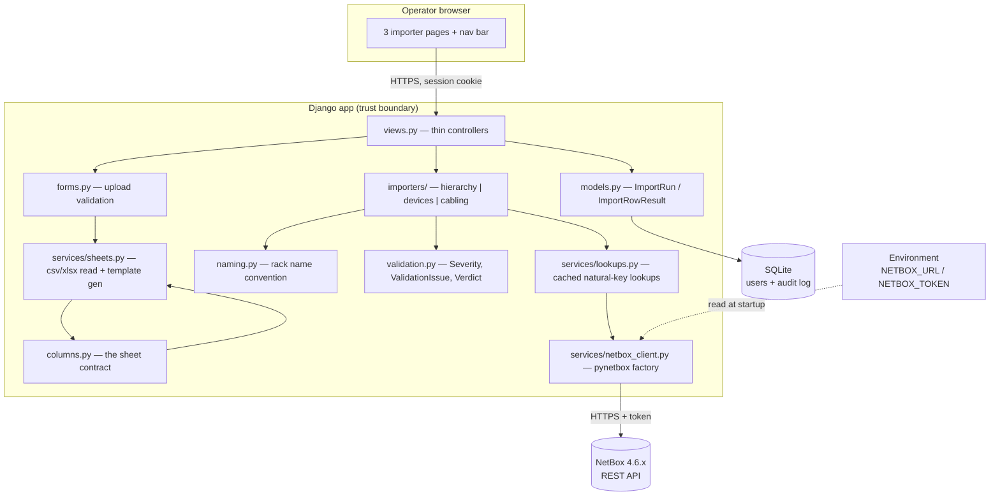
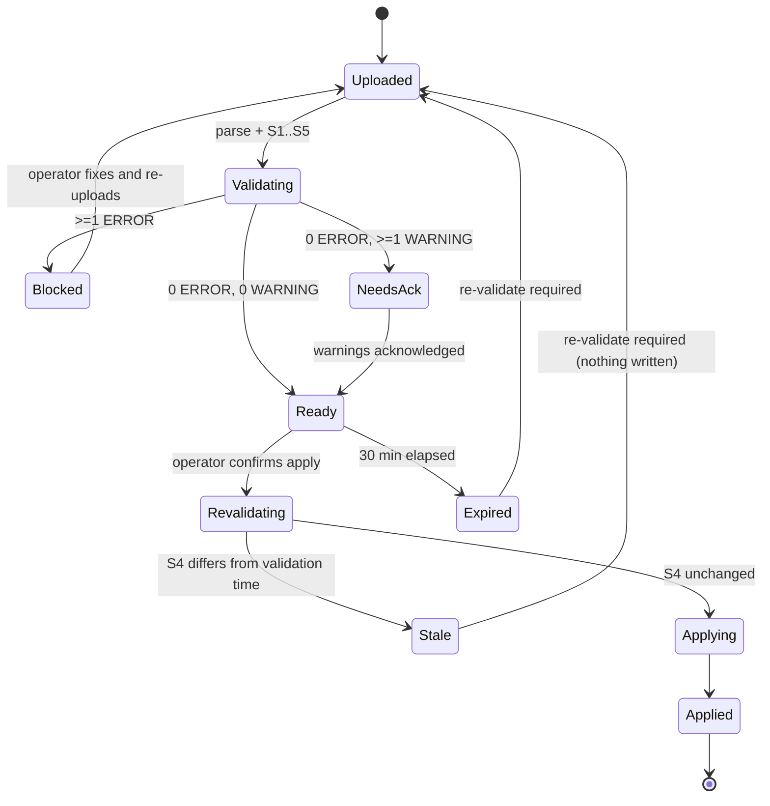
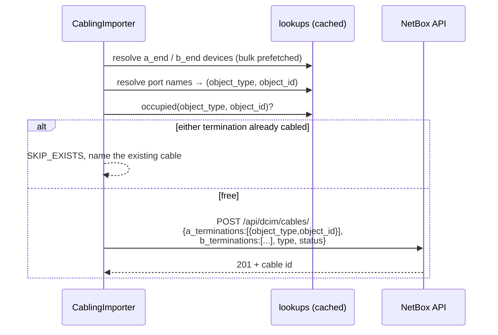

# Design — NetBox bulk provisioning (iteration 1: create only)

## Overview

A single-app Django site, server-rendered, with three importer pages. Each page follows the same
pipeline, gated so that **no write happens until the whole file validates clean**:

```
upload → parse → validate (S1..S5) → verdict
                                       ├── any ERROR ──→ blocked: report issues, apply disabled
                                       └── zero ERROR ─→ plan preview, apply enabled
                                                            ↓ operator confirms
                                                       re-run S4 (has NetBox moved?)
                                                            ├── changed → abort, nothing written
                                                            └── unchanged → apply → report
└──────────────── no writes to NetBox ────────────────┘                      └── writes ──┘
```

The gate is all-or-nothing per file: one bad row blocks the file. Partial application is not offered
even on request (Req 10.7), because a half-applied sheet is the exact failure this design exists to
prevent.

The app holds no copy of NetBox's inventory. Its only persistent data is the local user table and
an audit log of what each run submitted. NetBox stays the system of record.

Design status: **verified against NetBox 4.6.8 on 2026-08-18, implementation under way.** Every
decision D1–D8 in `requirements.md` is settled; each one's blast radius if reversed is named in the
table below. Field names in this document were checked against the target instance's own
`OPTIONS` responses rather than from memory — see "Verified against the target instance".

## Architecture



### Why this shape

- **Importers are plain Python, not views.** `validate` / `plan` / `apply` take rows and a client
 and return results, so every rule in `requirements.md` is unit-testable against a stubbed HTTP
 layer with no browser and no live NetBox.
- **One column definition.** `columns.py` drives template generation *and* parsing *and*
 validation. A downloaded template cannot drift from what the parser accepts (Req 4.2).
- **The plan is the unit of consent.** Preview renders a plan; confirm applies *that stored plan*,
 not a re-read of the file, which closes the swap-the-file-between-steps gap (Req 10.12).
- **Validation is a gate, not advice.** The apply endpoint's first act is to ask the stored verdict
 whether it is applyable. A blocked plan cannot be applied by crafting a POST, so the guarantee
 lives in the server, not in a disabled button (Req 10.6).

## The validation gate

### Stages

Ordered, and each stage only runs if the previous one left the file interpretable (Req 10.4).

| Stage | Checks | Needs NetBox? |
| --- | --- | --- |
| **S1** file structure | extension, size, worksheet present, required columns, unknown columns, example row still present | no |
| **S2** cell format | required-but-blank, integer/enum coercion, rack-name shape, choice values against cached API choices | choices only |
| **S3** intra-file consistency | duplicate racks, duplicate device names, RU-range overlap between rows, the same cable termination used twice, rack name disagreeing with its own datacenter/datahall columns | no |
| **S4** cross-reference | referenced racks/models/roles/tenants exist, ports resolve, terminations not already cabled, slugs and unique fields free, existing objects match the sheet | yes |
| **S5** feasibility | parent-before-child ordering resolvable, row count within the bound, no contradictory creates | no |

S4 is the only stage whose result can go stale, which is why it alone is re-run at apply time.

### Verdict state machine



Only the `Ready → Revalidating → Applying` path writes. Every other transition is read-only.

### Issue model

```python
class Severity(StrEnum):
    ERROR = "error"      # blocks the entire file
    WARNING = "warning"  # must be acknowledged, does not block
    INFO = "info"        # already-exists skips, ignored columns

@dataclass(frozen=True)
class ValidationIssue:
    severity: Severity
    code: str                      # stable, e.g. "RU_RANGE_OVERLAP"
    file: str                      # uploaded filename
    sheet: str                     # worksheet name; the filename for csv
    line: int | None               # spreadsheet line as seen in Excel, header = 1
    column: str | None             # header text, not the internal key
    value: str = ""                # what was received
    expected: str = ""             # what was required
    message: str = ""              # operator-facing sentence
    related_line: int | None = None       # the other row, for duplicates
    related_object: str | None = None     # "dcim.rack SYD1-DH1-R01"
    related_url: str | None = None        # deep link into NetBox

    def location(self) -> str:
        return f"file {self.file}, sheet {self.sheet}, line {self.line}, column {self.column}"
```

**Line numbering.** Parsed rows carry the spreadsheet line they came from, not their index in the
data. With a header on line 1 and a guidance row on line 2, the first data row is line 3 — and that
is the number reported, so "line 47" is the line the operator sees in Excel (Req 16.2).

Rendered form, matching the requested shape:

```
ERROR  RU_RANGE_OVERLAP
  file devices-syd1.xlsx, sheet Devices, line 47, column bottom_ru
  received "12", expected a range not overlapping rack SYD1-DH1-R01 front face
  syd1-dh1-r01-leaf01 would occupy U12-U13, already taken by line 31 (syd1-dh1-r01-leaf02)
```

### Plan and verdict types

```python
@dataclass
class Verdict:
    issues: list[ValidationIssue]
    stages_completed: list[str]          # e.g. ["S1","S2","S3"] when S4/S5 were not reached
    file_fingerprint: str                # sha256 of the upload; binds plan to file (Req 10.13)
    validated_at: datetime
    acknowledged_warnings: bool = False

    @property
    def errors(self) -> list[ValidationIssue]: ...
    @property
    def is_applyable(self) -> bool:
        """Zero errors, all stages reached, warnings acknowledged, not expired."""
```

`views.apply` calls `verdict.is_applyable` before anything else and returns 409 with the reason when
it is false. The template's disabled button is a courtesy; this check is the actual gate.

### Guarding the window between validation and apply

Validation proves the file was consistent with NetBox *at validation time*. Three things can still
intervene, and each has a specific mitigation:

| Risk | Mitigation | Requirement |
| --- | --- | --- |
| Someone else changes NetBox after validation | Re-run S4 immediately before the first write; abort with nothing written if anything moved | 10.14 |
| The operator edits and re-uploads the file | Plan bound to a sha256 fingerprint; a different file discards the verdict | 10.13 |
| A verdict sits in a stale browser tab for hours | Verdicts expire after 30 minutes | 10.15 |
| NetBox rejects a row mid-apply anyway | One bulk POST per endpoint: the whole list rolls back, so no rows from that endpoint are written | 12.4, D7 |

### Measured: bulk create is atomic (D7)

Run against NetBox 4.6.8 on 2026-08-18. Three failure classes were tested because they fail at
different points in the request and could plausibly behave differently. All three rolled back
completely:

| Test | Failure class | Response | Survivors |
| --- | --- | --- | --- |
| A | Field-level: item 2 of 3 missing a required `name` | `400` with a per-item array `[{}, {"name": [...]}, {}]` | none |
| B | Deferred DB constraint: two items in one list sharing a slug | `500` `duplicate key value violates unique constraint` | none |
| C | NetBox model `clean()`: two devices claiming the same rack unit | `400 {"position": ["U10.0 is already occupied ..."]}` | none |
| Control | All-valid list of two devices | `201` | both created |

Test B is the one that settles it. A field-level error proves only that DRF validates the whole list
before writing anything; it says nothing about transactions. B failed *during* the write — the first
insert succeeded and the second violated a database constraint — and the first was still rolled back.
NetBox wraps the request in a transaction.

**Consequence for apply:** creates are grouped by endpoint and issued as one bulk POST each. The
half-complete window is no longer "between any two rows" but "between two endpoints" — for the
hierarchy importer that is three boundaries (regions → sites → locations → racks) regardless of
whether the sheet has 4 rows or 4,000. Devices and cabling are single-endpoint, so each of those
sheets applies as one all-or-nothing operation.

**The catch — error attribution.** The three tests returned errors in two different shapes. Test A
came back as an array positionally aligned to the submitted items, so an error maps cleanly to a
spreadsheet line. Test C came back as a single un-indexed object: NetBox reported *that* a position
was occupied, not *which* item caused it. Requirements 12.2 and 16.1 demand line-level attribution,
so `apply` needs a fallback: when a bulk POST fails with an un-indexed error, replay the same list
row by row to identify the offender. That replay is safe precisely because the bulk attempt wrote
nothing. It is also rare by construction — a mid-apply failure means stage S4 missed something, which
is a validator bug worth surfacing.

**Residual risk, restated.** The remaining exposure is narrow but real: a multi-endpoint importer can
still fail on its second or third endpoint after the first succeeded, leaving, say, sites created
without their racks. That is recoverable and non-destructive — re-running the sheet skips what
exists and creates the remainder — but it is not nothing. NetBox offers no cross-request transaction,
so this cannot be closed without branching (see below).

Note also that TurboBulk, a NetBox Labs plugin, offers true dry-run validation with rollback, and
netbox-branching would allow the entire import to be staged in a branch and merged atomically across
endpoints, closing the residual window above. Neither is assumed here; netbox-branching would need a
licence review first.

## Verified against the target instance

Field names, required fields, and choice values below were read from the target's own `OPTIONS`
responses on NetBox 4.6.8 (2026-08-18) before any importer was written, because a column aimed at a
renamed field fails at apply time — after the operator has been told the file is clean.

| Checked | Result |
| --- | --- |
| Rack enumerated form factor | `form_factor`, **not** `type`. `rack_type` is a foreign key to the `RackType` model, so a `4-post-cabinet` string sent there would be rejected as an invalid id |
| `Rack.width` choices | `10, 19, 21, 23` — matches the sheet definition |
| `Rack.status` choices | `reserved, available, planned, active, deprecated` |
| Required on create | region/site/location: `name` + `slug` (location also `site`); rack: `name` + `site`; device: `device_type` + `role` + `site`; cable: nothing |
| `dcim.Location` slug | **required**, same as regions and sites — the spec previously derived slugs for regions and sites only |
| Slug validation | `^[-a-zA-Z0-9_]+$`, max length 100, uppercase accepted. The hyphen being legal in a NetBox slug is what forces the tool's own stricter rule on the two slugs a rack name is built from (Req 6.6) |
| `Device.face` choices | `front, rear` |
| `Cable.type` choices | includes `cat6`, `cat6a`, `mmf-om4`, `smf-os2`, `dac-passive` as the sheet examples assume |
| `Cable.status` / `length_unit` | `connected, planned, decommissioning` / `km, m, cm, mi, ft, in` |
| Front-port mapping format | `rear_ports: [{position, rear_port, rear_port_position}]`, the 4.5+ shape — confirmed by `scripts/seed_netbox.py` running against it |

Two things the live instance has that iteration 1 deliberately does not use: `Cable.profile` (cable
profiles, which is how NetBox 4.5+ expresses breakout) and `Cable.tenant`. The sample sheets in
`samples/` carry a `cable_profile` column left over from earlier exploration; like `transceiver`, it
is reported as an unrecognised column and ignored (Requirement 5.6). Adopting cable profiles is an
iteration 2 decision, not an oversight.

## Data classification and flow

| Store / flow | Classification | Handling |
| --- | --- | --- |
| `NETBOX_TOKEN` | CONFIDENTIAL | Environment only. Never rendered, logged, persisted, or included in an error. |
| `DJANGO_SECRET_KEY` | CONFIDENTIAL | Environment only. |
| Uploaded spreadsheet | INTERNAL | Parsed in memory / temp file, deleted in `finally`. Never written to a served path. |
| Plan held between preview and confirm | INTERNAL | Server-side session or short-lived DB row, scoped to the user, cleared on logout. |
| `ImportRun` / `ImportRowResult` | INTERNAL | Object ids, names, outcomes. No credentials, no file contents. |
| Local user table | CONFIDENTIAL (password hashes) | Django's default hasher. |
| App → NetBox | INTERNAL over TLS | HTTPS with certificate verification on. |

### Trust boundaries

1. **Browser → Django.** Untrusted request data even though the user is a trusted engineer:
 session auth, superuser check, CSRF on every mutation, upload type and size limits.
2. **Spreadsheet → Django.** The file is untrusted input regardless of who uploaded it. Formulas
 are not evaluated, cells are coerced explicitly, nothing is rendered as raw HTML.
3. **Django → NetBox.** The token crosses this boundary and must not cross any other.
4. **NetBox response → Django.** API responses are data, never instructions; error strings are
 escaped before display.

## Threat model

OWASP Top 10 baseline, scoped to what this app actually does.

| # | Threat | Vector | Mitigation | Requirement |
| --- | --- | --- | --- | --- |
| T1 | Token disclosure | Token echoed in a debug page, log line, or audit record | Env-only; `DEBUG=false`; explicit redaction in the error formatter; audit schema has no token field | 2.4, 12.7, 14.1 |
| T2 | Broken access control | Unauthenticated or non-superuser reaching an importer | `login_required` + superuser test on every view; default-deny mixin on the base view class | 1.2, 1.3 |
| T3 | Unauthorised bulk write (CSRF) | Forged POST applying a plan | CSRF token required; apply is POST-only; plan bound to the session that created it | 10.6, 10.17, 14.3 |
| T4 | Malicious upload | Zip-bomb / huge xlsx, formula injection, spoofed extension | Size cap before parse; extension + content-type allow-list; `openpyxl` read-only, values not formulas | 5.1, 5.2, 5.3 |
| T5 | Stored XSS via cell content | A cell containing markup rendered into the preview table | Django autoescaping; no `mark_safe` on sheet or NetBox values | 5.7, 14.4 |
| T6 | Destructive mistake at scale | A wrong sheet mass-creating objects | Create-only (never update/delete); mandatory preview; explicit confirm; idempotent skip | 10.1, 10.4, 11.3 |
| T7 | MITM on the NetBox path | Downgraded or unverified TLS | HTTPS only, verification on by default; override warns loudly in logs and UI | 2.3, 14.5 |
| T8 | CSV injection in exported reports | Report cell beginning `=`/`+`/`-`/`@` executing in Excel | Prefix formula-leading values with `'` when writing report CSVs | 12.6, 16.9 |
| T9 | Repudiation | No record of who ran a bulk change | Durable `ImportRun` per apply, UI-immutable, with actor and counts | 13.1, 13.5 |
| T10 | Partial-write confusion | Aborted run leaves NetBox half-populated and operator misled | Ordered record of applied creates; UI states rollback is not possible | 12.4, 12.5 |

**Known residual risk.** NetBox offers no cross-request transaction, so a batch can be partially
applied. Iteration 1 accepts this and mitigates with ordered audit records for manual unwind
rather than attempting compensating deletes, which could destroy pre-existing objects.

**Approval.** This threat model needs Security sign-off before implementation proceeds. Note also
that the working copy's `.env` contains a live production token committed to no repo but present
on disk — it should be rotated if it has ever been shared, and `.gitignore` now excludes it.

## Resolved decisions

| ID | Decision | Rationale | Blast radius if changed |
| --- | --- | --- | --- |
| D1 | Location → `dcim.Region`, Datacenter → `dcim.Site`, Datahall → `dcim.Location` | Matches NetBox's own geographic hierarchy; a Location is site-scoped, which is exactly what a datahall is | `importers/hierarchy.py` + lookups |
| D2 | Optional `device_role` column, falling back to `NETBOX_DEFAULT_DEVICE_ROLE`; reject if neither resolves | NetBox requires a role; silently inventing one would produce misleading data | `importers/devices.py` |
| D3 | Transceiver recording deferred to iteration 2; no such column exists | Setting `interface.type` cannot record anything once device types define interface types, and every other mechanism is a bigger change than iteration 1 warrants | nothing — the feature is absent |
| D4 | Device-type autocreate off by default, opt-in via env | Accidentally creating device types from typos pollutes a shared NetBox | `importers/devices.py` |
| D5 | Apply runs inline in the request, bounded by a max row count | No worker infrastructure for iteration 1 | `views.py` |
| D7 | Apply issues one bulk POST per endpoint, not one per row | Measured: NetBox wraps a list POST in a transaction, so a failure anywhere rolls the whole list back | `importers/base.py` |
| D8 | An "exists but differs" conflict blocks on consequential fields and warns on descriptive ones | A wrong region or rack height invalidates every row built on it; a wrong description invalidates nothing, and blocking on it would teach operators to distrust the gate | `columns.py` (`Conflict`) + S4 |
| D9 | Optional `datacenter_slug` / `datahall_slug` columns, and a rack name built from those slugs rather than from the two names | Deriving the slug from the name forced the name to double as the short code, so a site had to be called `SYD1` rather than "Sydney One" just to keep rack names short. Optional with a derived fallback keeps every existing sheet valid | `columns.py`, `naming.py`, `importers/hierarchy.py`, and the rack-name pattern all three sheets join on |

## Component design

### `columns.py` — the sheet contract

```python
class Conflict(Enum):
    """What it means when this column disagrees with an object that already exists (D8)."""
    CONSEQUENTIAL = "error"    # later rows are built on this; a mismatch blocks the file
    DESCRIPTIVE = "warning"    # nothing downstream reads it; acknowledge and carry on
    IDENTITY = "none"          # part of the natural key, so it cannot differ by definition

@dataclass(frozen=True)
class ColumnSpec:
    key: str                      # snake_case; also the exact header text
    label: str                    # human header shown in templates
    required: bool
    conflict: Conflict            # no default: adding a column forces the D8 decision (Req 11.5c)
    help_text: str                # rendered into the template guidance row
    choices: tuple[str, ...] = () # drives xlsx picklists and validation
    example: str = ""             # synthetic sample value
    numeric: bool = False         # compare as a number rather than as text

HIERARCHY_COLUMNS: tuple[ColumnSpec, ...]
DEVICE_COLUMNS: tuple[ColumnSpec, ...]
CABLING_COLUMNS: tuple[ColumnSpec, ...]
```

`IDENTITY` covers the columns used to *find* the existing object — a rack's name, a site's name.
They cannot conflict, because a different value means a different object, which is a create rather
than a match. Everything else is a judgement call the author of the column has to make:

| `CONSEQUENTIAL` — blocks | `DESCRIPTIVE` — warns |
| --- | --- |
| a site's region, a location's site and parent, a region's parent | `description` |
| `datacenter_slug`, `datahall_slug` | |
| `rack_u_height`, `rack_width` | `rack_status`, `rack_form_factor`, `status` |
| a device's `rack`, `bottom_ru`, `rack_face`, `model` | `tenant`, `serial`, `asset_tag` |
| a cable's `cable_type` | a cable's `label`, `color`, `length`, `length_unit` |

The two slug columns are `CONSEQUENTIAL` rather than `IDENTITY`, which is worth a sentence because
they *are* the natural key the lookup uses. `IDENTITY` means "cannot differ" — a different value
denotes a different object — and that holds while a slug is derived. Once the operator types one, a
supplied slug that disagrees with the matched object is a genuine disagreement to report and block
(Req 7.13), and the only class that produces that outcome is `CONSEQUENTIAL`. The derived fallback
never reaches this comparison at all (Req 7.14), so the classification only ever fires on a value
somebody actually wrote.

Comparison is asymmetric by type: identifiers, slugs, integers, and choice values must match
exactly, while free text is trimmed, whitespace-collapsed, and case-folded first, so `spine row A`
and `Spine Row A` are the same description and not a conflict (Req 11.5b).

`numeric` is declared per column rather than sniffed from the value. NetBox returns `19.0` where the
sheet says `19`, and those agree — but only for columns that are genuinely numbers. Inferring it from
the value would make a numeric-looking `label` compare differently from a textual one, which is a
difference in behaviour nobody chose. The flag is set on `rack_u_height`, `rack_width`, `bottom_ru`,
`ru_height`, and `length`.

### `naming.py` — rack name convention and slugs

```python
@dataclass(frozen=True)
class RackName:
    datacenter: str          # segment 1 — a slug, per D9
    datahall: str            # segment 2 — a slug
    rack: str
    raw: str
    def key(self) -> str: ...                            # case-folded, for comparison
    def agrees_with(self, *, datacenter_slug, datahall_slug) -> bool: ...

def parse_rack_name(value: str, delim: str | None = None, *, column: str = "rack") -> RackName:
    """Split into exactly 3 non-empty segments. Raises RowError otherwise."""

def build_rack_name(datacenter: str, datahall: str, rack: str, delim: str | None = None) -> str: ...
def expected_pattern(delim: str | None = None) -> str: ...   # for the `expected` field on an issue
def derive_slug(name: str) -> str: ...
def validate_slug(value: str, *, column: str, delim: str | None = None,
                  derived_from: str = "", advice: str = "") -> str:
    """NetBox's charset, minus the delimiter. Raises RowError otherwise."""
def effective_slug(name: str, supplied: str, *, column: str, name_column: str,
                   delim: str | None = None) -> str:
    """Supplied when non-blank, derived from the name otherwise (Req 7.10). Validates either way."""
```

`derived_from` and `advice` carry the two things a message about a *derived* slug needs and a message
about a supplied one does not: the name it came from, and the fact that the fix is to fill the slug
column in. They only change wording, never the verdict, and keeping them here rather than catching
and re-raising in `effective_slug` means all slug phrasing lives in one function.

The only module that knows the convention (Req 6.5); the delimiter defaults to `RACK_NAME_DELIMITER`.

`derive_slug` lives here rather than in each importer. NetBox requires a slug on regions, sites,
locations, device types, and manufacturers; only the hierarchy sheet asks for one, and only for two of
its three levels, so everywhere else the slug is derived from the name (Req 7.3) — and it has to be
derived *identically*, or two importers would disagree about which existing object a given name
refers to.

**Why `validate_slug` is two checks and not one regex.** NetBox accepts `^[-a-zA-Z0-9_]+$`, and the
rack name is split on `-`, so the two rules disagree about the hyphen and the operator needs to be
told which one they broke. A value outside NetBox's charset is one error ("letters, digits, hyphen and
underscore only"); a value inside it that contains the delimiter is a different error ("the rack name
is split on `-`; use `_`"). Writing it as a single narrowed regex would collapse both into one
message that is wrong for one of the two cases. The second check reads the delimiter from settings
rather than matching a literal hyphen, so configuring `_` as the delimiter forbids `_` and permits `-`
without touching this module's rules (Req 6.7).

**Why `effective_slug` takes both column names.** The fallback can itself produce an invalid slug:
`derive_slug("Data Hall 1")` is `data-hall-1`, which contains the delimiter. That row has to be
rejected, but pointing the error at `datahall_slug` — a cell the operator left deliberately blank —
tells them nothing. So the issue is located on the slug column when the value was supplied and on the
name column when it was derived, with a message that says to fill the slug column in. That is the one
piece of state this helper exists to carry; computing the slug is the easy half.

### `importers/base.py` — the shared pipeline

```python
class RowOutcome(StrEnum):
    CREATE = "create"; SKIP_EXISTS = "skip_exists"; BLOCKED = "blocked"

@dataclass
class PlannedRow:
    line: int                        # spreadsheet line, matching what Excel shows
    outcome: RowOutcome
    actions: list[CreateAction]      # ordered NetBox creates for this row
    issues: list[ValidationIssue]    # attached to this line, any severity
    resolved: dict[str, str]         # e.g. {"site": "SYD1", "rack": "SYD1-DH1-R01"}

@dataclass
class CreateAction:
    endpoint: str                    # "dcim.racks"
    payload: dict[str, Any]
    natural_key: dict[str, Any]      # used for the pre-create existence check
    refs: dict[str, Ref]             # parents created earlier in this same run

@dataclass
class Plan:
    rows: list[PlannedRow]
    verdict: Verdict
    importer: str

class BaseImporter(ABC):
    name: str
    endpoint_order: tuple[str, ...]           # the order bulk POSTs are issued in
    choice_sources: dict[str, tuple[str, str]]  # column -> (endpoint, field) for S2

    def validate(self, rows, *, lookups) -> Plan: ...   # runs S2–S5 and builds the Verdict
    def apply(self, plan) -> RunReport: ...

    # the only per-sheet surface
    def extra_cell_checks(self, row, collector) -> None: ...   # S2, optional
    def check_consistency(self, rows, collector) -> None: ...  # S3, optional
    def prefetch(self, rows, lookups) -> None: ...             # S4 bulk reads, optional
    def plan_row(self, row, lookups, registry) -> PlannedRow: ...  # S4/S5, required
```

**Built differently from the original sketch.** An earlier draft gave each importer three entry
points (`validate_local`, `validate_remote`, `plan`). Three importers implementing that protocol would
each have re-implemented stage ordering, the collector wiring, and the rule about which failures stop
the run — the exact logic Requirement 10.2 wants in one place. So `BaseImporter` owns one `validate()`
that runs S2 through S5 itself and calls four narrow hooks; only `plan_row` is mandatory. The
local/remote distinction still exists where it earns its keep: S2 and S3 touch no NetBox, so most of
the suite needs no HTTP at all, and S4 is re-runnable on its own because it is the stage that must be
repeated at apply time (Req 10.14).

`apply` refuses outright unless `verdict.is_applyable()`, re-runs S4, then issues one bulk POST per
endpoint in `endpoint_order`. If NetBox has become unreachable by then, that is reported as a clean
abort with zero writes rather than raised — the moment the operator most needs to be told nothing
happened is the worst possible moment to show them a traceback.

### `services/lookups.py` — idempotency and choices

Per-request cache keyed by `(endpoint, natural_key)`. Prefetches the referenced sets in bulk —
sites, locations, racks, device types, roles, and for cabling the terminations of every device
named in the sheet — so validating 2,000 rows is a handful of requests, not thousands (Req 15.2).

```python
def prefetch(endpoint: str, **filters) -> None: ...
def get_or_none(endpoint: str, **natural_key) -> Record | None: ...
def all_records(endpoint: str) -> list[Record]: ...
def count(endpoint: str, **filters) -> int: ...
def add_records(endpoint: str, records) -> None: ...   # so a just-created object is visible
def choices_for(endpoint: str, field: str) -> frozenset[str]: ...   # from the API, cached
def prefetch_terminations(device_ids, kind) -> None: ...
def terminations_for(device_id: int, kind: Literal["interface","frontport","rearport"]) -> dict[str, int]: ...
def occupied(object_type: str, object_id: int) -> Cable | None: ...
```

**Server-side filters are a bandwidth hint, not a source of truth.** Two NetBox behaviours, both
confirmed on 4.6.8, force that:

1. An unrecognised query parameter is *ignored*. `?bogus__lookup=x` returns **every** object with
   HTTP 200 instead of an error, so a mistyped filter name would look like a successful match against
   the wrong records. Every record returned is therefore re-verified locally against the natural key
   before it counts as a match.
2. Filtering by an id that no longer exists returns **400**, not an empty list. The pre-apply re-check
   reads that as "not found" — an object deleted since validation is drift to report, not a crash.

Matching is case-insensitive (Req 6.4, 11.1): the index is keyed on case-folded values while the
record keeps whatever casing NetBox holds.

### `services/netbox_client.py`

Builds the client from environment config, applies `NETBOX_VERIFY_SSL` and `NETBOX_TIMEOUT`, probes
`/api/status/` once per process for the version, and enforces the supported range `>=4.6, <4.7`.

`classify()` turns a raw exception into one of DNS / TLS / TIMEOUT / AUTH / CONNECTION / VERSION /
SERVER, each carrying a sentence naming the operator's next action, because "DNS does not resolve
netbox.example.com" and "the token was rejected" need different responses and a bare
`ConnectionError(...)` distinguishes them for nobody (Req 2.5). `redact()` runs over every message
before it becomes an exception, a log record, or template context.

Two things differ from the original sketch:

- **Requests do not go through `pynetbox`.** It raises `RequestError` with the response body
  interpolated into `str(e)`, which is precisely what Req 14.1 and task 21 must guarantee cannot
  happen. This module's own session gives redaction a single choke point — and it is the only place
  the token crosses (trust boundary 3).
- **The session refuses any method outside GET / OPTIONS / POST**, raising before a request is issued.
  The create-only invariant is then enforced by the transport rather than trusted separately in three
  importers.

## Sheet definitions

### Sheet 1 — hierarchy (one row per rack)

| Column | Req | Format / choices | NetBox target |
| --- | --- | --- | --- |
| `location` | yes | text | `dcim.Region.name` (+ derived slug) |
| `datacenter` | yes | text | `dcim.Site.name`, region = row's location |
| `datacenter_slug` | no | `[a-zA-Z0-9_]+`, no `-`; derived from `datacenter` when blank | `dcim.Site.slug`, and segment 1 of the rack name |
| `datahall` | yes | text | `dcim.Location.name`, site-scoped |
| `datahall_slug` | no | `[a-zA-Z0-9_]+`, no `-`; derived from `datahall` when blank | `dcim.Location.slug`, and segment 2 of the rack name |
| `rack` | yes | `<datacenter_slug>-<datahall_slug>-<rack>` | `dcim.Rack.name` |
| `rack_u_height` | yes | positive int | `Rack.u_height` |
| `rack_width` | no | 10 / 19 / 21 / 23, default 19 | `Rack.width` |
| `rack_status` | no | from API, default `active` | `Rack.status` |
| `rack_form_factor` | no | from API (`4-post-cabinet`, `4-post-frame`, …) | `Rack.form_factor` |
| `tenant` | no | existing tenant name | `Rack.tenant` |
| `description` | no | text | `Rack.description` |

Example row: `APAC, Sydney One, syd1, Data Hall 1, dh1, SYD1-DH1-R01, 45, 19, active, 4-post-frame, , spine row A`

That row is the case D9 was written for: two multi-word display names whose rack name is still
`SYD1-DH1-R01`, matching the slugs case-insensitively per Req 6.4. Leave both slug cells blank and the
row is rejected — `sydney-one` contains the delimiter — with the error on the `datacenter` column
telling the operator to fill `datacenter_slug` in. Blank slugs are only viable where the names are
already single tokens, which is precisely the pre-D9 sheet.

### Sheet 2 — devices

| Column | Req | Format / choices | NetBox target |
| --- | --- | --- | --- |
| `rack` | yes | existing rack name | `Device.rack` (+ site derived from it) |
| `rack_face` | yes | front / rear | `Device.face` |
| `bottom_ru` | yes | positive int | `Device.position` |
| `ru_height` | yes | positive int | validated against `DeviceType.u_height` |
| `device_name` | yes | text | `Device.name` |
| `model` | yes | existing device type model | `Device.device_type` |
| `serial` | no | text | `Device.serial` |
| `manufacturer` | no | required only when autocreating a type | `DeviceType.manufacturer` |
| `device_role` | no | existing role, default from env | `Device.role` |
| `status` | no | from API, default `active` | `Device.status` |
| `asset_tag` | no | text, unique in NetBox | `Device.asset_tag` |
| `tenant` | no | existing tenant | `Device.tenant` |

Example row: `SYD1-DH1-R01, front, 12, 2, syd1-dh1-r01-leaf01, DCS-7050SX3-48YC8, , Arista, leaf-switch, active, ,`

### Sheet 3 — cabling

| Column | Req | Format / choices | Notes |
| --- | --- | --- | --- |
| `a_end` / `b_end` | yes | device or panel name | must already exist |
| `a_end_kind` / `b_end_kind` | no | device / panel, default device | selects the termination model |
| `a_port` / `b_port` | yes | port name on that end | interface, or front/rear port for a panel |
| `a_port_side` / `b_port_side` | no | front / rear, default front | panels only; ignored for devices |
| `cable_type` | yes | from API (`cat6`, `cat6a`, `mmf-om4`, `smf-os2`, `dac-passive`, …) | |
| ~~`transceiver`~~ | — | — | dropped from iteration 1 (D3); treated as an unrecognised column if present |
| `cable_status` | no | default `connected` | |
| `label`, `color`, `length`, `length_unit` | no | `length_unit` from API | |

Example row: `syd1-dh1-r01-leaf01, device, Ethernet49/1, syd1-dh1-pp01, panel, Port 1, front, mmf-om4, QSFP-100G-SR4, connected, LNK-0001, , 3, m`

Termination mapping: `device` → `dcim.interface`; `panel` + `front` → `dcim.frontport`;
`panel` + `rear` → `dcim.rearport`.

## NetBox interaction

### Ordering

Hierarchy creates strictly parents-first: region → site → location → rack. Devices need racks, so
the device sheet only reads them. Cabling needs devices and their ports, so it only reads those.
Within a sheet, rows are applied in file order (Req 8.12) so the report lines up with the sheet.

### Cable creation



### Every write is a create

With transceiver recording deferred (D3), iteration 1 has **no** code path that modifies an object it
did not create. That is worth stating as an invariant rather than a coincidence: it makes the blast
radius of a mistaken import bounded by what it added, and it means a reviewer can verify the property
by grepping for `PATCH` and `DELETE` and finding none.

Why the interface-type route was abandoned: a device type defines interface templates, and devices
inherit their interfaces — already typed — from them. Requirement 11.3 forbids overwriting an
existing value, so the transceiver column could only ever confirm or contradict a type that was
already set, never record which optic is actually installed. Iteration 2 should use an inventory item
or a module, both of which can hold a part number.

Terminations are always sent as arrays on `/api/dcim/cables/`. The
`/api/dcim/cable-terminations/` endpoint is read-only in current NetBox and is never written to,
since bypassing the cables endpoint breaks path tracing.

## Data models (local, audit only)

```python
class ImportRun(models.Model):
    importer      = models.CharField(choices=["hierarchy", "devices", "cabling"])
    user          = models.ForeignKey(User, on_delete=models.PROTECT)
    filename      = models.CharField(max_length=255)
    netbox_host   = models.CharField(max_length=255)   # host only, no token
    netbox_version = models.CharField(max_length=32, blank=True)
    started_at    = models.DateTimeField(auto_now_add=True)
    finished_at   = models.DateTimeField(null=True, blank=True)
    created_count = models.PositiveIntegerField(default=0)
    skipped_count = models.PositiveIntegerField(default=0)
    error_count   = models.PositiveIntegerField(default=0)
    warning_count = models.PositiveIntegerField(default=0)
    # A blocked attempt is still a run: it is auditable even though nothing was written.
    # As built, the states are blocked | ready | applied | aborted | stale | expired | unavailable.
    # `aborted` (writes happened, then the run stopped) and `unavailable` (the target was refused
    # before the file was read) are distinct facts from `stale`, and an operator unwinding by hand
    # needs to tell them apart.
    verdict       = models.CharField(max_length=16)
    file_fingerprint = models.CharField(max_length=64) # sha256 of the upload
    stages_completed = models.CharField(max_length=32) # e.g. "S1,S2,S3"
    warnings_acknowledged = models.BooleanField(default=False)
    validated_at  = models.DateTimeField(null=True, blank=True)
    applied_at    = models.DateTimeField(null=True, blank=True)
    aborted_reason = models.CharField(max_length=255, blank=True)

class ImportRowResult(models.Model):
    run          = models.ForeignKey(ImportRun, related_name="rows", on_delete=models.CASCADE)
    line         = models.PositiveIntegerField()       # spreadsheet line as shown in Excel
    outcome      = models.CharField(max_length=16)     # RowOutcome
    object_type  = models.CharField(max_length=64, blank=True)   # "dcim.rack"
    object_id    = models.PositiveIntegerField(null=True, blank=True)
    object_name  = models.CharField(max_length=255, blank=True)
    message      = models.TextField(blank=True)
    sequence     = models.PositiveIntegerField()       # apply order, for manual unwind
    # As built, also `url` and `column`. The link is stored rather than rebuilt from NETBOX_URL, so a
    # link in an old report still resolves after the tool is repointed at a different instance;
    # `column` carries NetBox's own field-level error back to the offending cell (Requirement 12.2).

class ValidationIssueRecord(models.Model):
    """Persisted so a blocked attempt is auditable and re-openable (Req 16.11)."""
    run        = models.ForeignKey(ImportRun, related_name="issues", on_delete=models.CASCADE)
    severity   = models.CharField(max_length=8)
    code       = models.CharField(max_length=48, db_index=True)
    sheet      = models.CharField(max_length=255)
    line       = models.PositiveIntegerField(null=True, blank=True)
    column     = models.CharField(max_length=64, blank=True)
    value      = models.TextField(blank=True)
    expected   = models.TextField(blank=True)
    message    = models.TextField(blank=True)
```

Deliberately absent: the token, the uploaded file, and any raw cell dump. `value` holds only the
single offending cell, which is what makes the issue actionable.

## Pages and URLs

| URL | Name | Purpose |
| --- | --- | --- |
| `/login/`, `/logout/` | `login`, `logout` | Django auth views, local only |
| `/` | `importer:home` | Redirects to hierarchy; shows NetBox connection status |
| `/hierarchy/` | `importer:hierarchy` | Sheet 1 upload + verdict + preview |
| `/devices/` | `importer:devices` | Sheet 2 upload + verdict + preview |
| `/cabling/` | `importer:cabling` | Sheet 3 upload + verdict + preview |
| `/<page>/template.<csv\|xlsx>` | `importer:<page>_template` | Template download |
| `/<page>/validate/` | `importer:<page>_validate` | POST-only; upload + validate, never writes |
| `/<page>/acknowledge/` | `importer:<page>_ack` | POST-only; acknowledge warnings |
| `/<page>/apply/` | `importer:<page>_apply` | POST-only, CSRF-protected, refuses unless applyable |
| `/runs/`, `/runs/<id>/` | `importer:runs`, `importer:run_detail` | Audit history, read-only |
| `/runs/<id>/issues.csv` | `importer:run_issues` | Validation report CSV, formula-escaped |
| `/runs/<id>/report.csv` | `importer:run_report` | Apply result CSV, formula-escaped |

The three POST endpoints are POST-only because their views define no `get`, which makes the verb
restriction structural: Django answers 405 before any view code runs, so a link, a crawler, or a
mistyped URL cannot reach them. Both state changes redirect: validating goes back to the page and
applying goes to `/runs/<id>/`, so a refresh can neither re-upload nor re-apply. The server refuses a
second apply regardless — the redirect only means the operator never has to discover that.

UI is one `base.html` with the nav bar, plus three shared partials: `_verdict_banner.html` (the
blocked/ready summary), `_issue_list.html` (issues grouped by severity then line), and
`_preview_table.html` (the per-row plan).

### Where a validated plan lives between validate and apply

Requirement 10.12 says apply writes *the plan that was validated*, so the plan is held server-side and
the browser gets a run id. A crafted POST can therefore name a plan but cannot describe one.

It is held in Django's cache, not the session, because Django serialises sessions as JSON and a plan
is a graph of dataclasses holding `Ref`s and payloads. Hand-writing a codec for that would mean bugs
that are silent and whose failure mode is applying something subtly different from what was validated.
The cost is that the default cache backend is per-process: with more than one worker, an apply can land
on a process that never saw the plan. That fails safe — the plan is reported missing, nothing is
written, the operator re-validates — but a multi-worker deployment should configure a shared cache
backend. Iteration 1 assumes one operator and one process (assumption 3).

The session holds only `{importer: run_id}`, which is what makes a report survive navigating away, and
what logout clears (along with the cached plans themselves).

### Two counts, not one

`Verdict` carries `create_count` (rows) and `object_count` (objects). One hierarchy row can create a
region, a site, a location, and a rack, so "1 row" and "4 objects in NetBox" are different consents and
the apply button quotes the second. `object_count` counts distinct `(endpoint, key)` pairs rather than
actions, because twenty rows in one new datahall each carry an action for it and apply creates it once
(Requirement 7.6) — counting actions would overstate what the operator is authorising.

Styling is a single hand-rolled `static/css/app.css` — no CDN, no build step, and no vendored
third-party asset. This replaces an earlier "Bootstrap 5 from a pinned local static file": three
server-rendered pages, two banner styles, and two tables do not need a framework, and pulling one in
would add a supply-chain dependency to review and keep patched for styling this small. Revisit only
if the plan preview needs behaviour rather than layout.

Each importer page is a single screen with three stacked regions, so the operator never loses
context: the upload form, then the verdict banner with the issue list, then the plan preview with the
apply button. A blocked file shows regions one and two, with the apply button absent rather than
merely greyed out.

## Error handling

| Class | Stage | Handling | Operator sees |
| --- | --- | --- | --- |
| Bad type, oversize, missing columns | S1 | ERROR; stop, later stages not reached | All problems at once, with accepted formats and columns |
| Bad format, bad choice value | S2 | ERROR; file blocked | file / sheet / line / column, received, expected |
| In-file duplicate, RU overlap, reused termination | S3 | ERROR; file blocked | Both line numbers involved |
| Reference not found | S4 | ERROR; file blocked | Which lookup failed and the value tried |
| Already exists, all values match | S4 | INFO; does not block | Which object matched, with a NetBox link |
| Already exists, a consequential value differs | S4 | ERROR; file blocked (D8) | Field, sheet value, NetBox value |
| Already exists, a descriptive value differs | S4 | WARNING; must be acknowledged (D8) | Field, sheet value, NetBox value, and that NetBox's value stands |
| Unrecognised column, e.g. a leftover `transceiver` | S1 | INFO; does not block | The column name, and that it was ignored |
| Row count over the bound | S5 | ERROR; file blocked | The limit and the advice to split the file |
| NetBox moved since validation | pre-apply | Abort before the first write | What changed; re-validate required |
| Verdict expired or fingerprint changed | pre-apply | Refuse; re-validate | Why the verdict is stale |
| NetBox 400/500 despite validation | apply | The batch rolled back (D7): mark its rows `BLOCKED`, halt before the next endpoint | NetBox's error mapped to line and column, replaying row by row if it came back un-indexed |
| NetBox 401/403 | apply | Abort run | Auth failure with host, never the token |
| Connection loss / timeout | apply | Abort run | Rows applied before the abort, in order |
| Unexpected exception | any | Abort, log traceback server-side | Generic message + run id; no traceback, no headers |

`RowError(code, column, value, expectation)` is the single exception type carrying a row-level
failure; it converts directly into a `ValidationIssue`, so location and message formatting live in
one place and cannot leak internals.

Note the asymmetry in the "NetBox 400 despite validation" row: it means our validator missed
something. Every occurrence is a bug in a validation stage, so its issue code is logged for follow-up
rather than treated as normal operation.

## Testing strategy

Live NetBox is never contacted in tests, and an autouse fixture in `importer/tests/conftest.py` fails
any test that tries to open a socket, so hermeticity is enforced rather than assumed.

There are two levels of double, deliberately:

- **`responses`** stubs raw HTTP for the client, lookups, and readiness — the layers whose job *is*
  HTTP status codes, headers, and redaction.
- **`FakeNetBox`** (`importer/tests/fakes.py`) is an in-memory instance for importer tests, which care
  about object state across many rows rather than wire format. It reproduces the API behaviours that
  change outcomes: unrecognised query parameters ignored, list POSTs atomic, choices fetched once per
  endpoint, and read or write failures injectable per endpoint. Asserting a 2,000-row overlap check
  through hand-written HTTP stubs would test the stubs.

The whole suite runs in about five seconds, which is why it gets run on every change.

- **Unit — `naming.py`:** valid 3-segment names, wrong segment counts, empty segments, alternate
 delimiter, case-insensitive comparison (Req 6); and for slugs, the NetBox charset accepted,
 underscore accepted, hyphen rejected, over-length rejected, a name with nothing slug-able in it,
 supplied-versus-derived precedence, and — the one that protects Req 6.7 — that configuring `_` as
 the delimiter flips which of `-` and `_` is the forbidden character.
- **Unit — `sheets.py`:** csv and xlsx parsing, reordered headers, case/whitespace in headers,
 missing required column, unknown column warning, blank rows, oversize rejection, formulas read
 as values, template round-trip (generate → parse yields the declared columns) (Req 4, 5).
- **Unit — importers, one test per numbered criterion:**
 - hierarchy: parent-before-child ordering, slug derivation and collision, duplicate rack rows,
 rack name vs slug disagreement, same datahall name under two datacenters (Req 7); plus the D9
 cases — a supplied slug reaching the create payload verbatim, a blank slug falling back to the
 derived one, a derived slug containing the delimiter reported against the *name* column, one name
 carrying two slugs, two names carrying one slug, the same datahall slug reused under a second
 datacenter being legal, a supplied slug disagreeing with an existing object blocking, and the same
 disagreement from a derived slug not blocking
 - devices: face validation, RU overflow past rack height, overlap with an existing device and
 with another row, `ru_height` vs device-type height mismatch, missing model with autocreate off
 then on, role fallback then failure, duplicate device name (Req 8)
 - cabling: device vs panel resolution, front vs rear side, ambiguous and missing ports,
 termination array payload shape, cable-type validation, already-occupied skip, same-port both
 ends, duplicate termination across rows (Req 9)
- **Create-only invariant:** across the whole suite, assert that no test ever causes a `PATCH`,
 `PUT`, or `DELETE` request to NetBox. This is the machine-checkable form of Requirement 11.3 and it
 is what makes the "we cannot damage what we did not create" claim verifiable rather than aspirational.
- **The gate — the highest-value tests in the suite (Req 10):**
 - a file with exactly one ERROR writes **nothing**: assert zero POST requests were issued
 - a forged POST to the apply endpoint on a blocked plan returns 409 and issues zero requests
 - partial application is not reachable by any request shape
 - zero errors plus unacknowledged warnings is not applyable; acknowledging makes it applyable
 - S1 failure reports which stages were not reached, and emits no S4 issues
 - all issues in a stage are reported in one pass, not just the first
 - a changed file fingerprint invalidates the verdict
 - a verdict older than the expiry window is refused
 - **stale detection:** stub NetBox to return a different state on the pre-apply S4 than during
 validation, then assert the run aborts with zero writes
- **Issue localisation (Req 16):** line numbers match the spreadsheet including the header and
 guidance rows, csv reports the filename as the sheet, duplicates name both lines, every issue
 carries a code, the CSV export escapes formula-leading values, display truncation kicks in at the
 cap while the CSV keeps everything.
- **Idempotency:** validate and apply the same file twice against a stubbed NetBox that starts
 empty; the second validation finds zero errors and the second apply creates nothing (Req 11.7).
- **View tests:** anonymous redirect, non-superuser 403, validate writes nothing, apply requires
 POST + CSRF, applying a plan twice is refused, logout clears the pending plan (Req 1, 10).
- **Security regression:** assert the token appears in no rendered page, log record, or
 `ImportRun` row, including on the error path (Req 14.1).
- **Fixtures:** synthetic only — `example.com`, fake serials, invented site codes. No production
 data, per policy.

## Configuration

Everything is an environment variable; `.env.example` is the full list. The ones that carry a
requirement rather than a preference:

| Variable | Default | Requirement |
| --- | --- | --- |
| `NETBOX_URL` / `NETBOX_TOKEN` | none — startup fails naming the variable | 2.1, 2.2 |
| `NETBOX_VERIFY_SSL` | `true`; `false` warns in the log and banners the UI | 2.3 |
| `NETBOX_TIMEOUT` | 30s | 2.5 |
| `RACK_NAME_DELIMITER` | `-` | 6.1 |
| `NETBOX_DEFAULT_DEVICE_ROLE` | unset; a device row with no `device_role` is then rejected | 8.8, D2 |
| `NETBOX_AUTOCREATE_DEVICE_TYPES` | `false` | 8.7, D4 |
| `MAX_UPLOAD_MB` | 5 | 5.2 |
| `PLAN_EXPIRY_MINUTES` | 30 | 10.15 |
| `MAX_APPLY_ROWS` | 2000 | 15.3 |
| `MAX_ISSUES_DISPLAYED` | 500 | 16.10 |

## Deployment notes

Iteration 1 targets local/internal use: `runserver` for development, gunicorn behind an internal
reverse proxy otherwise. The development server defaults to port **8080**, since Django's usual 8000
is where a local netbox-docker instance listens and the two must not fight over it. Requirements: Python 3.12–3.14, `DJANGO_DEBUG=false`, explicit
`ALLOWED_HOSTS` and `CSRF_TRUSTED_ORIGINS`, SQLite on a backed-up path, and a rotated NetBox token
scoped to the DCIM writes this tool needs. `python manage.py check --deploy` must be clean before
anyone else is pointed at it.
